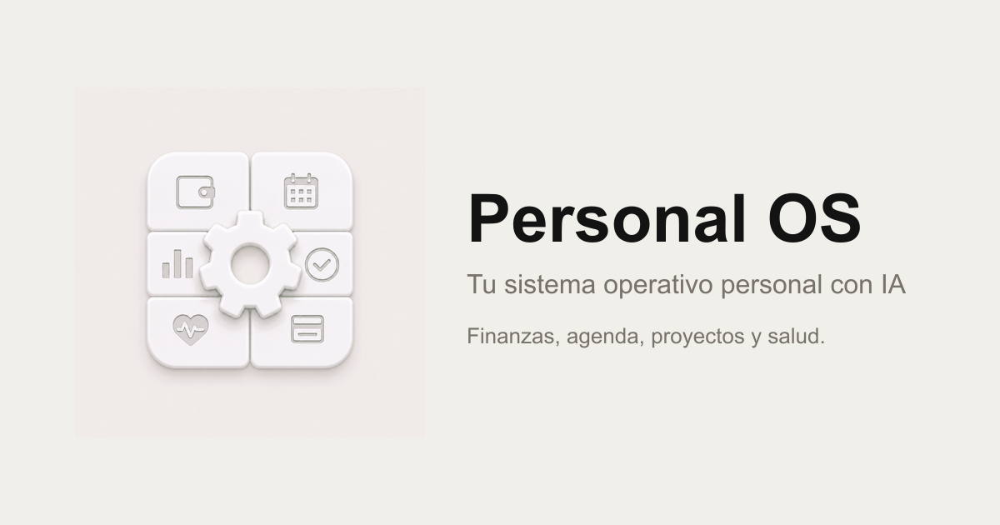
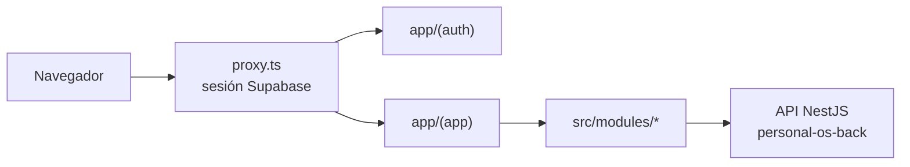

<p align="center">
  
</p>

<h1 align="center">Personal OS — Web</h1>

<p align="center">
  Finanzas personales, inteligencia de correo, notificaciones y ajustes de tus apps en un solo cliente web.
</p>

<p align="center">
  
  
  
  
  
  
  
</p>

**Estado:** beta (`0.x`). Política de versiones en [docs/versionado.md](./docs/versionado.md).

## Qué es

Personal OS reúne en una sola cuenta las áreas de tu vida que suelen vivir en hojas de cálculo y apps sueltas. Este repositorio es el cliente web: la interfaz que abre la persona. La API y el dominio viven en [personal-os-back](https://github.com/jarvinc3/personal-os-back).

La app principal es **Finanzas**, pensada para cuentas en pesos dominicanos y dólares en bancos como Popular, BHD, Banreservas, Qik y APAP. Agenda, Proyectos y Salud se activan y configuran desde Ajustes; sus pantallas de uso todavía no están en este cliente.

## Apps y funciones

| App            | Qué hace                                                                                                                                                                                                        | Rutas            |
| -------------- | --------------------------------------------------------------------------------------------------------------------------------------------------------------------------------------------------------------- | ---------------- |
| Finanzas       | Instituciones, cuentas, tarjetas, movimientos, transferencias, estados de cuenta, presupuestos, metas de ahorro, préstamos, cobros, suscripciones, importación de extractos, comercios, analítica y patrimonio. | `/finance/*`     |
| Inteligencia   | Vista privada del correo de Gmail conectado, detalle de cada mensaje con su contenido crudo, saneado y canónico, y consentimiento para contribuir al conocimiento global.                                       | `/intelligence`  |
| Notificaciones | Bandeja dentro de la app, push del navegador y avisos en tiempo real.                                                                                                                                           | `/notifications` |
| Keep Awake     | Mantiene la pantalla despierta durante una sesión, con recordatorios y ventana flotante.                                                                                                                        | `/keep-awake`    |
| Inicio         | Entrada después del login con accesos a tus apps.                                                                                                                                                               | `/home`          |
| Ajustes        | Perfil, apariencia, apps activas, finanzas, agenda, proyectos, salud, privacidad, notificaciones, región y borrado de datos.                                                                                    | `/settings/*`    |
| Ayuda          | Guías, preguntas frecuentes y glosario de la app.                                                                                                                                                               | `/help/*`        |

## Stack

| Pieza              | Tecnología                                                        |
| ------------------ | ----------------------------------------------------------------- |
| Framework          | Next.js 16 (App Router) y React 19                                |
| Estilos            | Tailwind CSS 4 y componentes shadcn en `src/shared/components/ui` |
| Datos del servidor | TanStack Query sobre el envelope `{ data, meta }` de la API       |
| Estado del cliente | Zustand                                                           |
| Autenticación      | Supabase con `@supabase/ssr`; la sesión se refresca en `proxy.ts` |
| Tiempo real        | `socket.io-client`, namespace `/notifications`                    |
| Push               | Web Push con VAPID y `public/sw.js`                               |
| Errores            | Sentry en cliente, servidor y edge                                |
| Pruebas            | `node --test` con cobertura, sin framework adicional              |

## Arranque

```bash
cp .env.example .env.local
pnpm install
pnpm dev
```

El cliente queda en `http://localhost:3000`. Todas las variables están documentadas en [.env.example](./.env.example): Supabase, URL de la API, Web Push (VAPID), Logo.dev y Sentry. Sin DSN de Sentry, la SDK no se inicializa.

## Scripts

| Script               | Qué hace                                   |
| -------------------- | ------------------------------------------ |
| `pnpm dev`           | Next en desarrollo con Turbopack           |
| `pnpm build`         | Build de producción                        |
| `pnpm start`         | Sirve el build de producción               |
| `pnpm lint`          | ESLint                                     |
| `pnpm format:check`  | Prettier sobre `ts`, `tsx` y `md`          |
| `pnpm typecheck`     | `tsc --noEmit`                             |
| `pnpm test`          | Pruebas de reglas con `node --test`        |
| `pnpm test:coverage` | Las mismas pruebas con umbral de cobertura |

## Arquitectura

`app/` solo compone rutas: `(auth)` para entrar y `(app)` para la aplicación con sidebar y header. Cada app vive en `src/modules/<slug>/` y expone su API pública desde `index.ts`; lo compartido está en `src/shared/`. `proxy.ts` refresca la sesión de Supabase y protege las rutas privadas. Un único cliente HTTP habla con la API NestJS.



Detalle en [docs/architecture/overview.md](./docs/architecture/overview.md) y reglas de módulo en [docs/architecture/module-conventions.md](./docs/architecture/module-conventions.md).

## Documentación

| Documento                                                  | Para qué                                           |
| ---------------------------------------------------------- | -------------------------------------------------- |
| [docs/README.md](./docs/README.md)                         | Mapa completo de la documentación                  |
| [docs/architecture/](./docs/architecture/README.md)        | App Router, frontera de módulos y UI compartida    |
| [docs/modules/](./docs/modules/README.md)                  | Una guía por app: alcance, reglas y contratos      |
| [docs/operations/runbook.md](./docs/operations/runbook.md) | Arranque, diagnóstico y despliegue                 |
| [docs/glosario.md](./docs/glosario.md)                     | Qué se llama App en la interfaz y módulo en código |
| [AGENTS.md](./AGENTS.md)                                   | Flujo de trabajo y fuentes canónicas               |
| [docs/issue-conventions.md](./docs/issue-conventions.md)   | Cómo se escriben los issues                        |

## Repositorios

| Repositorio                                                            | Rol                                 |
| ---------------------------------------------------------------------- | ----------------------------------- |
| [personal-os-web](https://github.com/jarvinc3/personal-os-web)         | Cliente web (este repositorio)      |
| [personal-os-back](https://github.com/jarvinc3/personal-os-back)       | API NestJS, dominio y base de datos |
| [personal-os-landing](https://github.com/jarvinc3/personal-os-landing) | Sitio público y páginas legales     |

## Licencia

MIT. Ver [LICENSE](./LICENSE).
