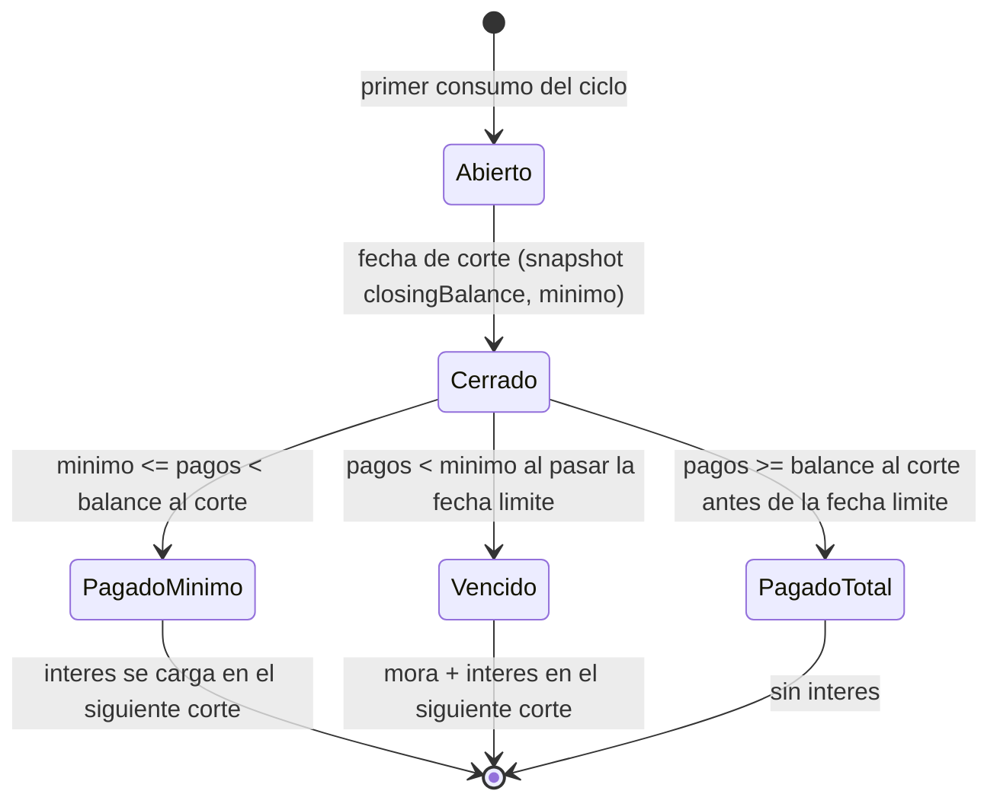
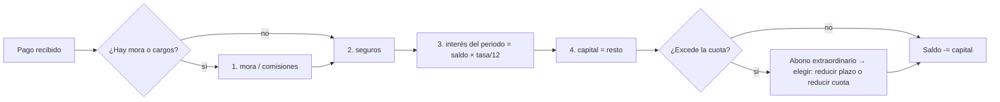
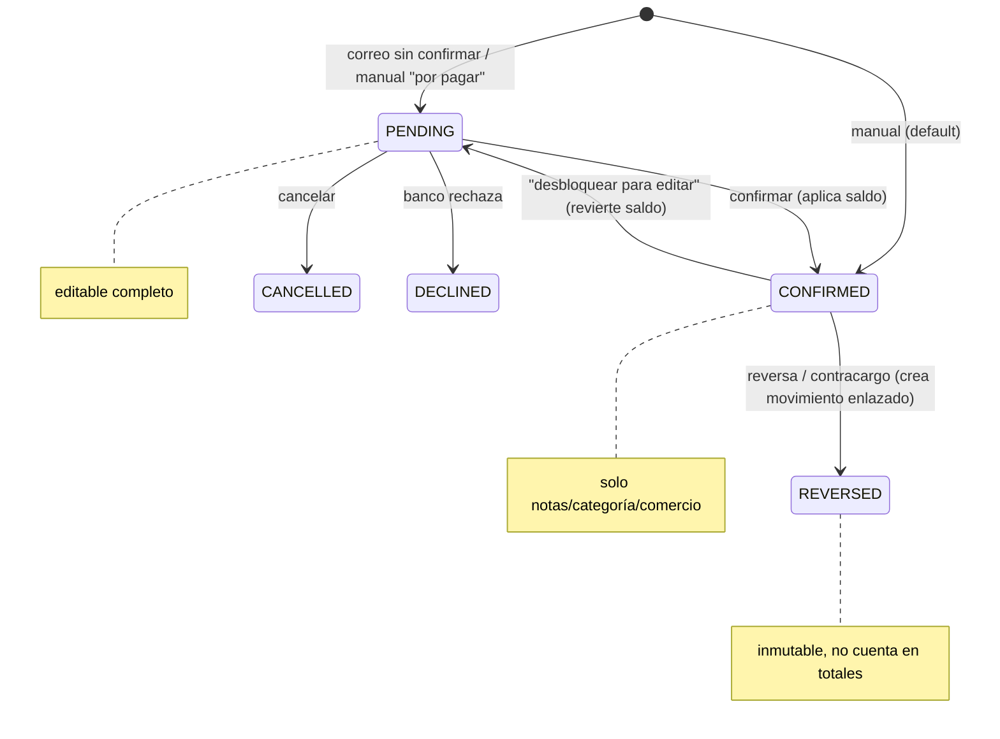

# Finanzas Personal OS: análisis del dominio y mejoras

> **Contexto:** Personal OS es una app con modulos de la vida diaria, uno de ellos es el de finanzas personales para República Dominicana (DOP/USD; Popular, BHD, Banreservas, Qik, APAP). **Fecha:** 12 oct 2026.
> **Código revisado:** rama `develop` de `personal-os-back` (`1fd5ceb2`) y de `personal-os-web` (`9f8944fd`). **Estado revisado de nuevo el 12 oct, 9:20 AM (hora RD), contra back** `b768249` **(v1.5.2) y web** `69e7004` **(v1.4.3). Ver §5.**
> **Leyenda:** ✅ = el código ya lo soporta · ⚠️ = parcial · ❌ = no existe. Lo que no verifiqué en el código está marcado como **[sin verificar]**.

## 0. Resumen de decisiones firmes

| Pregunta abierta                                     | Decisión                                                                                                                                                                                                           |
| ---------------------------------------------------- | ------------------------------------------------------------------------------------------------------------------------------------------------------------------------------------------------------------------ |
| ¿Se puede editar una transacción revertida?          | **No.** Una reversa es un hecho contable que no se edita. Si hubo un error, se crea un movimiento nuevo. Solo se permiten cambiar las notas y la categoría                                                         |
| ¿El dinero de una meta va separado o solo apartado?  | **Apartado (_earmark_) dentro de una cuenta bancaria real.** Opcionalmente, la meta se marca como "cuenta dedicada" si el usuario tiene una cuenta o _vault_ aparte en el banco                                    |
| ¿Presupuesto de una categoría o de varias?           | **De varias categorías (grupo).** El presupuesto de una sola categoría queda como el caso con N=1                                                                                                                  |
| ¿Integrar transferencias con ahorro y planificación? | **Sí, pero solo por enlace.** Una transferencia hacia la cuenta de la meta puede marcarse como "aporte". La transferencia no crea la meta ni la mueve por su cuenta                                                |
| ¿Cómo se paga una tarjeta?                           | **Es un tipo propio de movimiento,** `CARD_PAYMENT`**:** dos patas enlazadas, igual que una transferencia. En la UI no se presenta como "transferencia" ni como un "gasto" que cuente en el presupuesto (ver §2.2) |

---

## 1. Cómo funciona el dominio frente a cómo lo modela el módulo

### 1.1 Cuentas y saldos

**Cómo funciona en la realidad:**

- El banco maneja dos saldos:
  - **Contable (_ledger/posted_):** solo cuenta lo liquidado.
  - **Disponible:** el contable menos las **retenciones** (_holds_, autorizaciones pendientes) y los depósitos en tránsito.
- Una compra con tarjeta primero se **autoriza** (baja el disponible) y días después se **liquida** (_posted_). La autorización puede vencer o anularse, y entonces se libera la retención.
- Un **contracargo** (_chargeback_) o reverso devuelve un cargo que ya estaba liquidado.

Fuentes: [Hancock Whitney: available vs ledger](https://www.hancockwhitney.com/support/what-is-the-difference-between-my-available-balance-and-my-ledger-balance), [TD: available vs posted](https://www.td.com/us/en/personal-banking/learning/money-management/available-balance-vs-posted-balance), [Stripe: balance transaction types](https://docs.stripe.com/reports/balance-transaction-types).

**Cómo lo modela el módulo:**

- Hay un solo `balance` por cuenta y por `FinCardBalance` por moneda.
- Los `PENDING` no tocan el saldo, y al pasar a `CONFIRMED` lo aplican (BR-FIN-001/009).
- `REVERSED` crea un movimiento enlazado (`linkedTransactionId`).
- Los correos con estado AUTHORIZED o IN_PROGRESS se guardan como `PENDING`.

**Brecha y sugerencia:**

- **Hoy el módulo solo tiene el saldo contable.** Propongo calcular un **disponible estimado** = saldo − Σ `PENDING` de débito, sin columna nueva, y mostrar los dos ("Disponible ~ / Contable").
- Una autorización pendiente que nunca se liquida debe **vencer**: pasados N días (sugerido 7–10), sugerir "¿Se canceló?".
- La "liquidación" debe **actualizar** el `PENDING` existente, no crear otro. Es justo el caso de los duplicados que viene de los correos (ver §1.9).

### 1.2 Tarjetas de crédito (RD)

**Cómo funciona en la realidad** (Reglamento de Tarjetas de Crédito de la Junta Monetaria y las circulares de la SB):

- **Fecha de corte:** cierra los consumos, cargos y pagos del ciclo y genera el **estado de cuenta**.
- **Fecha límite de pago:** el último día para pagar el **balance al corte** sin intereses, o al menos el **pago mínimo**.
- **Interés por financiamiento:** si no pagas el balance al corte completo, pagas interés sobre el **saldo insoluto promedio diario**, en base 360. **Se prohíbe cobrar interés sobre interés.**
- **Pago mínimo:** todos los intereses, comisiones y cargos + al menos **1/36 del capital vigente** + el capital vencido de meses anteriores.
- **Comisión por mora:** se cobra si no pagas el mínimo a tiempo, y se calcula sobre la porción de capital del mínimo.
- **Avances de efectivo:** generan interés desde el día del avance; no tienen periodo de gracia.
- **Tarjetas bimoneda (DOP/USD):** muy comunes en RD. Llevan un balance y un mínimo por moneda, y se pagan en cada moneda.

Fuentes: [Reglamento de Tarjetas de Crédito (SB)](https://sb.gob.do/media/zgyl2t3i/reglamento-de-tarjetas-de-credito.pdf), [Circular SB 005/11: instructivo de intereses](https://www.proconsumidor.gob.do/documentos/Circ_005-11_instructivo_para_calculo_de_intereses_y_comisiones_aplicables_a_tarjetas_de_creditos.pdf), [Circular SB (definiciones de pago mínimo y fecha límite)](https://sb.gob.do/media/oqwjh2z1/18788125319378ci.pdf).

> Nota: el marco legal es la **Ley Monetaria y Financiera 183-02** y su Reglamento de Tarjetas de Crédito. No encontré una "Ley 183-17" de tarjetas.

**Cómo lo modela el módulo:**

- ✅ `FinCardBalance` por moneda (bimoneda soportada), con `creditLimit` y `balance` (= **disponible**).
- ✅ Día de corte y día de pago. ✅ `FinCardStatement` materializa el `closingBalance` **por ciclo y moneda**, más `dueDate` (scheduler). La web muestra los cortes en el detalle de la tarjeta.
- ❌ No hay **pago mínimo**, intereses, comisiones ni avances de efectivo.
- ❌ No hay **detalle del corte**: el único endpoint es `GET /cards/:id/statements` (lista). No existe `GET /cards/:id/statements/:id` con sus movimientos.
- ⚠️ El pago a la tarjeta hoy es una **transferencia cuenta→tarjeta** (`create-transfer` acepta `toCardId`).

**Brecha y sugerencia:**

1. **Separar los tres saldos** que ve el usuario en la tarjeta:

- **disponible** = límite − deuda;
- **balance actual** = deuda de hoy;
- **balance al corte** = deuda al cierre del último ciclo, es decir, lo que hay que pagar para no generar intereses.

2. **Calcular el "pagado del corte":** suma de pagos desde `cycleEnd` hasta `dueDate`. Con eso se obtiene el estado del corte: `ABIERTO → CERRADO → PAGADO_TOTAL | PAGADO_MÍNIMO | VENCIDO`.
3. **Pago mínimo:** guardarlo en el corte como dato **importado** (correo o PDF), no calcularlo, porque cada banco lo calcula a su manera. Como respaldo, estimarlo con la regla 1/36 + cargos.
4. **Tipos de cargo nuevos:** `INTEREST`, `FEE`, `CASH_ADVANCE`. Pueden ser categorías del sistema con un _flag_, para que no se confundan con consumo.

### 1.3 Préstamos

**Cómo funciona en la realidad:**

- **Sistema francés:** la cuota es fija y en cada cuota el interés va primero, sobre el saldo, y el resto va a capital.
- **Tasa:** se publica **anual**, y la tasa del periodo es la anual entre 12 (mensual).
- **Fija o variable:** una tasa variable cambia la cuota en cada revisión.
- **Otros cargos:** la cuota suele incluir **seguros** (vida o desgravamen, y en vehículos e hipotecas, el seguro del bien) y puede tener **mora**.
- **Abono extraordinario a capital:** el usuario **elige** entre **reducir el plazo** (misma cuota, menos meses) o **reducir la cuota** (mismo plazo), y el banco emite una nueva tabla.
- **Penalidad por pago anticipado:** puede aplicar según el contrato. El tarifario de Banesco, por ejemplo, la calcula sobre el monto anticipado. Algunos bancos solo aceptan abonos si la cuota regular está al día.

Fuentes: [ProUsuario: abonos extraordinarios, ¿cuota o tiempo?](https://www.prousuario.gob.do/educacion-financiera/blog/abonos-extraordinarios-a-pr%C3%A9stamos-reducci%C3%B3n-de-cuota-o-tiempo/), [ProUsuario: abono al capital y saldo anticipado](https://prousuario.gob.do/educacion-financiera/blog/quieres-hacer-un-abono-al-capital-o-saldo-anticipado-de-tu-cr%C3%A9dito-toma-esto-en-cuenta/), [ABA: estrategias de abono](https://aba.org.do/articulos-perspectivas/abono-al-capital-del-prestamo-estrategias-reducir-cuota-plazo/), [Banesco: normativos](https://www.banesco.com.do/normativo-regulatorio/), [Scotiabank: calculadora de penalidad](https://do.scotiabank.com/acerca-de-scotiabank/calculadoras/calculadora-de-penalidad-por-pago-anticipado-de-prestamo-personal-e-hipotecario-retail.html).

**Cómo lo modela el módulo:**

- ✅ `FinLoan` guarda la cuota fija, la frecuencia, el total y las pagadas, el saldo, `interestRate` (fracción anual) y `nextDueDate`.
- ✅ `FinLoanInstallment` guarda número, vencimiento, `amount`, `paidAt` y `transactionId`.
- ✅ El asistente web calcula con el sistema francés y despeja la tasa.
- ⚠️ `pay-next-installment` **resta la cuota completa del saldo** (`currentBalance - installmentAmount`). **Eso es incorrecto en el sistema francés:** solo la parte de capital baja el saldo. Con tasa > 0, el saldo que muestra la app baja más rápido que el real.
- ❌ **No hay abonos extraordinarios a capital** (no existe endpoint ni modelo), ni penalidad, seguros, mora o tasa variable.

**Brecha y sugerencia:**

- **Distribuir cada pago** en `interest`, `principal`, `insurance`, `fees` y `lateFee` (columnas en `FinLoanInstallment` o una tabla `FinLoanPayment`). El saldo solo baja por `principal`.
- **Nuevo endpoint** `POST /loans/:id/prepayments` con `{ amount, accountId, mode: 'REDUCE_TERM' | 'REDUCE_INSTALLMENT', penalty? }`. Debe recalcular la tabla futura (las cuotas impagas) y guardar el abono como movimiento.
- **Al crear el préstamo:** pedir `insuranceMonthly`, `rateType` (FIXED o VARIABLE) y una `prepaymentPenaltyPct` opcional.

### 1.4 Transferencias (RD)

**Cómo funciona en la realidad:**

- **Mismo banco:** inmediata y normalmente gratis.
- **Interbancaria ACH** (CARDNET): de lunes a viernes. Lo enviado entre 8:00 AM y 1:00 PM se acredita a partir de las 2:00 PM; lo enviado después, al día laborable siguiente. Puede tardar hasta 24 h.
- **LBTR / Pagos al Instante BCRD:** de 7:00 AM a 11:00 PM los 7 días (con un cierre de 4:00 a 6:30 PM los días laborables) y se acredita en unos 8 minutos. Tiene **comisión** (referencia BCRD: RD$100 o US$5, aunque la fija cada entidad). El BCRD avanza hacia pagos instantáneos 24/7.

Fuentes: [ProUsuario: ACH vs LBTR](https://prousuario.gob.do/educacion-financiera/blog/conoces-la-diferencia-entre-transferencias-ach-y-lbtr-o-transferencias-al-instante-bcrd/), [Scotiabank RD: Pagos al Instante](https://do.scotiabank.com/banca-personal/servicios/pagos-al-instante.html), [BCRD: Proyecto SGPI](https://cdn.bancentral.gov.do/documents/sistema-de-pagos/informacion-general/documents/Proyecto_SGPI_Angel_Gonzalez.pdf), [Reglamento de Sistemas de Pago 2025](https://cdn.bancentral.gov.do/documents/normativa/documents/2da-Res-JM-28-08-2025-Mod-Reglamento-SIPARD.pdf).

**Cómo lo modela el módulo:**

- ✅ Dos patas con `transferGroupId`. ✅ FX por cada pata. ✅ Editar con `PATCH /transfers/:id`, aunque **sin restringir por estado** y **sin atomicidad entre las dos patas**.
- ❌ No hay comisión ni "en tránsito": las dos patas nacen con el mismo estado.

**Brecha y sugerencia:**

- **Agregar** `fee` (opcional): una tercera pata `DEBIT` en el origen con la categoría "Comisiones bancarias" y el mismo `transferGroupId`.
- **Agregar** `rail` (`SAME_BANK | ACH | LBTR | OTHER`) para mostrar "llega hoy a las 2 PM o mañana".
- **Estados por pata:** la pata de origen `CONFIRMED` y la de destino `PENDING` hasta que llegue, lo que permite confirmarla después a mano o por correo.

### 1.5 Metas de ahorro

**Cómo funciona en la realidad (y en las apps):**

- Los bancos ofrecen **subcuentas** reales (Revolut Vaults, "bolsillos" o cuentas de ahorro programado).
- Las apps de presupuesto, en cambio, **apartan** dinero sin moverlo:
  - **YNAB:** las metas son _targets_ de categoría sobre dinero que ya existe.
  - **Monarch:** _fund allocations_, es decir, asignar parte del saldo de una o varias cuentas a la meta. Se pueden vincular transferencias o ingresos a la meta y decidir si el gasto reduce el progreso.

Fuentes: [Monarch: Save Up Goals](https://help.monarch.com/hc/en-us/articles/44373182867476-Using-Save-Up-Goals), [Monarch: Goals reimagined](https://www.monarch.com/blog/goals), [YNAB vs Monarch](https://www.ynab.com/blog/ynab-vs-monarch).

**Cómo lo modela el módulo:**

- ✅ Desde `697cdafa`, el aporte exige `accountId` y crea un `DEBIT` "Aporte: < meta>". **El dinero "sale" de la cuenta como gasto.**
- ⚠️ Eso **distorsiona la realidad:** el dinero sigue en tu banco y además infla el gasto y los presupuestos.

**Brecha y sugerencia:** ver la decisión en §2.10. El aporte **no debe ser un gasto**. Debe ser un _earmark_ (asignación) sobre una cuenta, o una **transferencia** si la meta tiene su propia cuenta real.

### 1.6 Presupuestos

**Cómo funciona en la realidad:**

- **Por categoría con tope (tracking):** es el modelo de Monarch, que también tiene _flex budgeting_ por grupos.
- **Sobres / _zero-based_ (YNAB):** "dale un trabajo a cada peso", con **rollover** del sobrante o del exceso.
- Lo habitual es agrupar: Vivienda, Comida (súper + restaurantes), etc.

Fuentes: [Monarch vs YNAB, zero-based](https://www.monarch.com/blog/how-monarch-compares-to-ynabs-zero-based-budgeting), [budgettools: comparativa](https://budgettools.net/ynab-vs-monarch).

**Cómo lo modela el módulo:** `FinBudget` tiene **una sola** `categoryId`, un periodo y `amountSpent` materializado, más una alerta por umbral. No tiene rollover, grupos ni subcategorías. **[sin verificar]** No revisé si cuenta las subcategorías hijas.

**Sugerencia:** presupuestos **multicategoría** con una tabla puente `FinBudgetCategory`, un `rollover: NONE | SURPLUS | BOTH` opcional e **incluir los hijos** de cada categoría.

### 1.7 Cuentas por cobrar

**Cómo funciona en la realidad (contabilidad):**

- Los cobros parciales son normales.
- Si el deudor **paga de más**, el excedente queda como **saldo a favor**: se devuelve, se aplica a otra deuda o se registra como ingreso o propina.
- Una deuda incobrable se **castiga** (_write-off_): se cierra como pérdida, sin fingir que se cobró.

**Cómo lo modela el módulo:** ✅ pagos parciales con un `CREDIT` enlazado. ❌ Un excedente da **400** (`Payment cannot exceed the outstanding amount`). Existe el estado `CANCELLED`, pero **no hay castigo con monto** perdido.

**Sugerencia:** ver §2.11.

### 1.8 Recurrentes y suscripciones

**En la realidad:** un recurrente se detecta por el mismo comercio, un monto parecido (±10%) y una periodicidad (7, 14, 30 o 365 días ± tolerancia). De ahí salen "próximo cobro", "subió de precio" y "no llegó".

**En el módulo:** ❌ `FinRecurringPattern` existe solo en el esquema (sin REST, fachada ni tools). El comercio es texto libre y `isRecurring` no se usa.

**Sugerencia:**

1. Normalizar el comercio con una tabla `FinMerchant`: nombre canónico, alias, logo y categoría por defecto.
2. Un job nocturno que llene `FinRecurringPattern`.
3. Una vista "Suscripciones" donde confirmar o descartar cada patrón.

### 1.9 Ingesta de correos y deduplicación

**En la realidad:**

- Los bancos suelen mandar **varios correos por el mismo hecho**: autorización, consumo y a veces un recordatorio, o "transferencia enviada" y "transferencia recibida".
- Los reenvíos tienen otro `Message-ID` pero el **mismo número de referencia o autorización**.
- Un reverso puede venir con la referencia del original o sin ella.

**Buenas prácticas:**

- **Clave de idempotencia** (_idempotency key_) fuerte: `(institución, referencia)` o `(institución, hash de remitente+asunto+cuerpo normalizado)`.
- **Coincidencia aproximada** (_fuzzy match_) para "probable duplicado": mismo destino (últimos 4 o cuenta), mismo monto y moneda, ±48 h y similitud de comercio ≥ 0.8.
- La "liquidación" de una autorización se **fusiona** con la original.

**En el módulo:** ✅ único `(sourceId, gmailMessageId)` y `emailMessageId` único en la transacción. ✅ Hay `externalReference` con índice **no único** `(userId, externalReference)`, y existe el _outcome_ `SKIPPED_DUPLICATE` y `match-email-transfers`.

**Causa probable de los reversos duplicados** (deducción a partir del código, no confirmada con datos):

1. Llegan dos correos distintos (Message-ID distintos) del mismo reverso.
2. La referencia no viene o el LLM la extrae distinta.
3. `resolve-reverse-original` encuentra el **mismo** original para los dos y crea dos reversos, porque `reverse` es idempotente sobre el original pero el segundo correo sigue su propia ruta. **[sin verificar en datos]**

**Sugerencia:**

- (a) Índice **único parcial** en `(userId, institutionId, externalReference) WHERE externalReference IS NOT NULL`.
- (b) Antes de crear un reverso, comprobar si **ya existe una transacción con** `linkedTransactionId = original` y, si existe, marcar el correo como `SKIPPED_DUPLICATE`.
- (c) Coincidencia aproximada de ±48 h, mismo monto y destino → `POSSIBLE_DUPLICATE` para revisión.
- (d) Guardar `fingerprint` (hash del cuerpo normalizado) en `FinEmailMessage`.

### 1.10 Conciliación y ajustes de saldo

**En la realidad (y en contabilidad de empresas):**

- La **partida doble** asegura que cada movimiento tenga contrapartida (débito = crédito).
- La **conciliación bancaria** compara el saldo del libro contra el del estado del banco. La diferencia se explica con partidas en tránsito, o se registra como **ajuste** contra una cuenta de "diferencias".
- Los ajustes no son "gastos" ni "ingresos": son correcciones.

**En el módulo:**

- ✅ `POST /balance-adjustments` crea `type: ADJUSTMENT`. Está **en la misma tabla** de movimientos y el listado lo trata como un tipo filtrable más (`prisma-ledger.repository.ts`). **[sin verificar]** No revisé si la web lo excluye del tablero.
- ✅ `amountSpent` solo se calcula con DEBIT confirmados de una categoría, y un ajuste no tiene categoría.

**Sugerencia:**

- **Conciliación ligera:** "Saldo según tu banco: ____" → el sistema muestra la diferencia, los `PENDING` que la explican y ofrece crear un ajuste.
- **Mostrar ajustes:** guardarlos **fuera del tablero** y mostrarlos en el historial de la entidad (ver §2.3).
- **Partida doble completa:** **no** es necesaria para finanzas personales. Las transferencias de dos patas ya cubren el 90%.

---

## 2. Respuesta punto por punto a tus observaciones

### 2.1 Transacciones

**Estado actual del código:**

- `PATCH /transactions/:id` **no** restringe por estado: el `UpdateTransactionUseCase` permite cambiar monto y destino en una confirmada y reajusta saldos. **[revisé el repositorio; no encontré una restricción por estado]**
- `reverse` solo funciona en `CONFIRMED` que no sea transferencia.

**Decisión** (máquina de estados de abajo):

- `PENDING`**:** se edita todo.
- `CONFIRMED`**:** bloqueado. Ofrecer **"Marcar como pendiente para editar"**, que revierte el efecto en el saldo, deja editar y luego "Confirmar". Las notas, la categoría y el comercio **sí** se editan sin desbloquear: no tocan saldo y sí afectan el presupuesto, pero eso ya se recalcula.
- `REVERSED` **/** `CANCELLED` **/** `DECLINED`**:** **sin edición**, salvo notas y categoría. Se pueden "duplicar como nuevo".

**Implicaciones por capa:**

- **API:** `PATCH` devuelve 409 `TRANSACTION_LOCKED` si cambian campos monetarios en no-`PENDING`. Nuevo `POST /transactions/:id/unconfirm`.
- **UI:** candado en el formulario y banner "Este movimiento está completado".

**Tablero:**

- Los `REVERSED` y `CANCELLED` se muestran con opacidad 50%, el monto en gris y tachado, y la etiqueta "Revertido". **No cuentan** en totales ni gráficos; el back ya los excluye porque solo suma `CONFIRMED`.
- El reverso enlazado se agrupa visualmente con el original.

**Flujo de creación:** tras elegir categoría → foco en el monto y abrir el **teclado numérico o la calculadora** según la última preferencia guardada (localStorage `finance.amountInput = keypad|calculator`) → al confirmar el monto, abrir el selector de cuenta o tarjeta. **Solo es UI**: `amount-calculator-sheet.tsx` ya existe.

**Integraciones** (cuando gestionas una transacción, según el tipo):

| Tipo    | Vincular a                                                                                   |
| ------- | -------------------------------------------------------------------------------------------- |
| Gasto   | Cuota de préstamo ("es la cuota 5 de BHD"), presupuesto (informativo) y gasto desde una meta |
| Ingreso | Pago de un cobro, aporte a una meta                                                          |

**API:** `POST /transactions/:id/link { kind: LOAN_INSTALLMENT|RECEIVABLE_PAYMENT|SAVINGS_CONTRIBUTION, targetId }`. Reutiliza las relaciones `transactionId` que ya existen en esas tablas. Es muy útil para los movimientos importados por correo.

### 2.2 Transferencias

**Estado del código:** ✅ `transferGroupId`. ⚠️ Se puede editar en cualquier estado y la edición no es atómica. ⚠️ **El destino puede ser una tarjeta** (`toCardId`) y el origen nunca lo es.

**Decisiones:**

1. **Edición:** solo si las dos patas están en `PENDING`, igual que en las transacciones. El `UpdateTransferUseCase` debe envolverse en **una** `prisma.$transaction`.
2. **Destino:** en "Transferir" el destino siempre es una **cuenta**. El pago de tarjeta sale del formulario de transferencia y pasa a ser una acción **"Pagar tarjeta"**.

- **Mi matiz frente a tu propuesta:** contablemente, pagar una tarjeta **no es un gasto**. El gasto ya ocurrió cuando hiciste los consumos. Si lo registras como `DEBIT` con categoría, **contarías doble** en presupuestos y estadísticas.
- **Recomendación:** un tipo propio, `CARD_PAYMENT`, con dos patas enlazadas: `DEBIT` en la cuenta y `CREDIT` en la tarjeta, que **sube el disponible**. Va con una categoría del sistema "Pago de tarjeta" **excluida de presupuestos y del gasto**.
- Se aplica al **corte** abierto o cerrado: cuenta como "pagado del corte" si cae entre `cycleEnd` y `dueDate`. En el tablero se muestra como "Pago a Visa BHD" con icono propio, no como transferencia.
- Con eso obtienes lo que pides (resta de la cuenta, suma al disponible y alimenta el corte) sin romper los presupuestos.

3. **Tablero:** mostrar **una sola fila** por `transferGroupId` ("Popular → BHD · RD$5,000", con los dos logos). En el detalle de cada cuenta se ve solo su pata con el signo correcto.
4. **Flujo:** se abre el selector de origen → luego el de destino (filtrado: solo cuentas, sin la de origen) → foco en el monto. Es solo UI.
5. **¿Integrar con ahorro?** **Sí, por enlace:** si el destino es la cuenta asignada a una meta, preguntar "¿Contar como aporte a 'Viaje'?" y crear el aporte enlazado a la transferencia.

### 2.3 Ajustes de saldo

**Estado del código:** ✅ se guardan como `FinTransaction` de tipo `ADJUSTMENT`. **[sin verificar]** No revisé si la web los oculta.

**Decisión:** excluir `ADJUSTMENT` por defecto en `GET /transactions` (un parámetro `includeAdjustments=false`) y mostrarlo en un **historial de la entidad** con un icono ⚙⚙ (`Settings2` doble o `Cog`). Esa vista mezcla ajustes, cambios de límite y cortes. Los ajustes siguen afectando el saldo y no cuentan en las estadísticas.

### 2.4 Bug: borrar institución deja los préstamos

**Lo que muestra el código:**

- `schema.prisma`: `FinLoan.institution` tiene `onDelete: Cascade`, y la migración `20261008124049_finance_cascade_institution_category` recrea `fin_loans_institution_id_fkey ... ON DELETE CASCADE`.
- `CatalogService.deleteInstitution` además llama `repo.deleteLoansByInstitution` (`finLoan.deleteMany({ userId, institutionId })`).
- `FinLoan.account` también tiene `onDelete: Cascade`.

**Conclusión:** con `institutionId` = la institución, el préstamo **sí** se borra. Lo que viste se explica por una de estas causas:

- **(a)** El préstamo se creó con `institutionId = null`: modo "persona" o el formulario viejo, con el prestamista como texto, y la institución nunca quedó enlazada.
- **(b)** La base de datos donde probaste no tiene aplicada la migración del 8 oct.

**Recomendación:**

- Correr `prisma migrate status` en ese entorno.
- Al borrar una institución, borrar también los préstamos **cuya** `accountId` **pertenezca a la institución**. Esos ya caen por la cascada de la cuenta, así que el caso que queda es (a).
- En el diálogo, listar "Se eliminan N préstamos".

### 2.5 Scroll infinito y paginación por cursor

**Estado:** ✅ con cursor `{items,nextCursor,hasMore}` solo están `GET /transactions`, `GET /budgets` y notificaciones (`97585ba9`). ❌ Todo lo demás devuelve arrays.

**Recomendación:** paginar donde crece sin límite:

- `GET /loans/:id/installments`
- `GET /receivables/:id/payments`
- `GET /savings-goals/:id/contributions`
- `GET /cards/:id/statements`
- `GET /email-sync/messages` y `/pending`
- el historial de sincronización

Catálogos chicos (cuentas, tarjetas, instituciones, categorías) quedan sin paginar. En la web, un hook común `useInfiniteFinanceList` con IntersectionObserver.

### 2.6 Detalle del corte de tarjeta y carga de estados de cuenta

**Estado:** ✅ lista de cortes. ❌ No hay detalle. ⚠️ "Leer estado de cuenta" solo lleva a `/finance/sync`.

**Recomendación:**

1. `GET /cards/:id/statements/:statementId` → corte + movimientos del ciclo + pagos aplicados + mínimo + estado (diagrama §1.2). En la web, una **hoja** con el resumen (balance al corte, mínimo, fecha límite y cuenta regresiva) y la lista de movimientos.
2. **Carga de PDF:** `POST /cards/:id/statements/import` (multipart) → job → extractor LLM, igual que el de correos → devuelve `{closingBalance, minimumPayment, dueDate, movements[]}` → pantalla de **conciliación**: movimientos que coinciden, que faltan en la app y que sobran.
3. **Desde el correo:** muchos bancos envían "Tu estado de cuenta está disponible", a veces con el PDF adjunto. Hay que añadir un `outcome` `STATEMENT` en la ingesta y enrutarlo al mismo importador.

### 2.7 Préstamos: cuotas, historial y abonos

**¿El código soporta abonos extraordinarios?** **No.** Solo existe `pay-next-installment`, y además resta la cuota completa del saldo (§1.3).

**Recomendación:**

- **UI:** tarjeta de cuota con "Cuota 5 de 36 · vence 15 nov · RD$12,450 (capital 9,100 · interés 3,350)". Al tocarla se abre una hoja con el detalle y el historial: pagada el día X desde la cuenta Y, con enlace al movimiento.
- **Abono a capital:** botón "Abonar a capital" → monto → elegir **reducir plazo** o **reducir cuota**, con una vista previa del ahorro en intereses ("ahorras RD$38,200 y terminas 7 meses antes") → aviso de posible penalidad según el contrato.
- **API:** `POST /loans/:id/prepayments` y `GET /loans/:id/schedule` (tabla de amortización proyectada).

### 2.8 Cuentas por cobrar: pago de más

**Estado:** ❌ hoy da 400.

**Recomendación:** aceptar el **monto real** y, si excede lo pendiente, preguntar qué hacer con el excedente (`excessHandling`):

| Opción                  | Efecto                                                         |
| ----------------------- | -------------------------------------------------------------- |
| `TIP_INCOME`            | El excedente se registra como ingreso aparte ("Propina/extra") |
| `CREDIT_BALANCE`        | Queda como saldo a favor del deudor, que se devuelve después   |
| `NEW_RECEIVABLE_OFFSET` | Se aplica a otro cobro del mismo deudor                        |

Por debajo: un solo movimiento `CREDIT` por el monto total; el pago aplica `min(monto, pendiente)` y el excedente se registra según la opción. Además, agregar un **castigo** (`POST /receivables/:id/write-off`), que cierra el cobro con el monto perdido.

### 2.9 Correo: OAuth, pantalla de consentimiento y deduplicación

**Redirect URI:** las rutas de la web cambiaron (ahora hay `/finance/sync` y vistas nuevas).

- El callback de Google apunta al **back** (`/api/finance/email-sync/oauth/google/callback`), y ese 302 vuelve a la web usando el `returnTo` firmado, que debe estar en `CORS_ORIGIN`.
- En Google Cloud → Credentials → OAuth client, verifica que esté **exactamente** la URL del callback del back, por entorno (local, preview y prod).
- Si `returnTo` apunta a una ruta vieja de la web, se rompe la vuelta pero no el OAuth.

**Por qué ves advertencias y IDs raros:**

| Síntoma                                                                         | Causa                                                                                                                      | Arreglo                                                                                                                                                                                                         |
| ------------------------------------------------------------------------------- | -------------------------------------------------------------------------------------------------------------------------- | --------------------------------------------------------------------------------------------------------------------------------------------------------------------------------------------------------------- |
| "Google no verificó esta app"                                                   | `gmail.readonly` es un ámbito **restringido**. Sin verificación sale el aviso y el uso queda limitado a usuarios de prueba | Configurar _branding_ y pedir verificación de ámbitos restringidos. Incluye video demo y **evaluación de seguridad CASA** anual, porque los datos pasan por tu servidor                                         |
| Sale `xxxx.supabase.co` en lugar de "Personal OS" (inicio de sesión con Google) | Google muestra el dominio del callback. Supabase Auth usa el dominio del proyecto                                          | **Dominio personalizado de Supabase** (p. ej. `auth.tudominio.com`, por CNAME) y añadir **los dos** callbacks en el cliente OAuth; o completar la **verificación de marca** para que se vea el nombre de la app |
| Nombre o logo ausentes                                                          | La pantalla de consentimiento no está publicada o verificada                                                               | Branding: nombre, logo, correo de soporte, inicio, política de privacidad y **dominios autorizados** (el dominio privado superior de la web y de los redirects), y verificar el dominio en Search Console       |

Fuentes: [Google: Unverified apps](https://support.google.com/googleapi/answer/7454865?hl=en), [Google: restricted scope verification](https://developers.google.com/identity/protocols/oauth2/production-readiness/restricted-scope-verification), [Google: brand verification](https://developers.google.com/identity/verification/authentication-verification), [Supabase: custom domains](https://supabase.com/docs/guides/platform/custom-domains), [Nylas: ámbitos restringidos de Gmail y CASA](https://developer.nylas.com/docs/provider-guides/google/google-verification-security-assessment-guide/).

> Advertencia práctica: CASA cuesta y se renueva cada 12 meses. Mientras la app sea de uso personal, puedes mantenerla en modo **Testing** con tu cuenta como usuario de prueba. Los tokens de refresco de apps en _testing_ **vencen a los 7 días**, y eso explicaría los errores de "tokens" al reconectar. **[sin verificar en tu proyecto]**

**Después de vincular:** un paso más en el flujo: "¿Sincronizar automáticamente?" (toggle `emailSync.automatic`) → selector de horario (cada 15 min / 1 h / 6 h, o horas fijas). El back ya lo soporta (`UserModule.config.emailSync.schedule`, mínimo 15 min).

**Duplicados de reversos:** ver §1.9 (índice único parcial + comprobar el reverso existente + coincidencia aproximada).

### 2.10 Metas de ahorro: cuenta y separación del dinero

**Decisión:**

- **La meta se asigna a una cuenta bancaria** (`FinSavingsGoal.accountId`, solo cuentas, nunca tarjetas).
- **El aporte no es un gasto:**
  - **Si la meta usa la misma cuenta del día a día** (_earmark_): el aporte es solo una **asignación**, sin movimiento. El saldo de la cuenta se divide en "Disponible libre = saldo − Σ metas" y "Apartado".
  - **Si la meta tiene su propia cuenta** (cuenta de ahorro o _vault_): el aporte es una **transferencia** de la cuenta principal a la de la meta, con un enlace al aporte.
- **Cambio frente al código actual:** hoy (`697cdafa`) el aporte crea un `DEBIT`, que infla el gasto. Hay que cambiarlo a "sin movimiento" o "transferencia".
- **Retiro de la meta:** permitir "Usar dinero de la meta", con la opción de que el gasto reduzca el progreso, igual que Monarch.

### 2.11 Presupuestos: una o varias categorías

**Decisión:** **varias categorías** (`FinBudgetCategory`), que incluyan las subcategorías.

- Plantillas: "Comida = Supermercado + Restaurantes + Delivery".
- Rollover opcional.
- La alerta se mantiene por umbral.
- El índice único actual `(userId, categoryId, periodStart, periodEnd)` pasa a ser una validación de "categoría ya presupuestada en ese periodo".

### 2.12 Agente de IA

**Estado:**

- Las tools cubren sobre todo lectura, movimientos, presupuestos y metas.
- Faltan préstamos y cobros (escritura), catálogo, cortes y conciliación.
- El préstamo ya se puede rellenar por enlace (`/finance/loans/new?...`).

**Recomendaciones:**

1. **Paridad de tools con la fachada:**

- `create_loan` (o el enlace de prefill), `prepay_loan`, `record_receivable_payment`
- `link_transaction`, `get_card_statement`, `import_statement`, `adjust_balance`
- `list_pending_emails` / `assign_pending_email`
- Las tools que escriben deben pedir confirmación.

2. **Contexto del módulo de origen:** pasar `?from=finance&entity=loan:<id>` al abrir el agente desde un módulo, o mejor, que el botón del agente envíe `moduleSlug` y `entityRef` al crear la sesión. El back ya filtra tools por `moduleSlug`.
3. **Respuestas duplicadas y streaming:**

- Hay que usar SSE o streaming de tokens con un `clientMessageId` **idempotente**, para que un reintento no genere dos respuestas.
- Además, deshabilitar el envío mientras hay un _stream_ activo.
- **[sin verificar]** No revisé el código del chat.

4. **Componentes visuales en el chat:** bloques tipados (`{type:'transaction_card'|'budget_progress'|'chart'|'confirm_action'}`) renderizados con los componentes del módulo.
5. **Modos más allá del chat:**

- **Captura rápida** ("café 250 popular") desde la barra del módulo.
- **Sugerencias en contexto:** "este correo parece la cuota de BHD", "este pago parece suscripción".
- **Resumen semanal automático.**

---

## 3. Hoja de ruta priorizada

Esfuerzo: S = ≤1 día · M = 2–4 días · L = 1–2 semanas.

| Prioridad        | Ítem                                                                                                                | Esfuerzo      |
| ---------------- | ------------------------------------------------------------------------------------------------------------------- | ------------- |
| **P0 (bugs)**    | Saldo del préstamo: restar solo capital en `pay-next-installment` (y en la tool)                                    | S             |
| P0               | Reversos duplicados por correo: comprobar el reverso existente + índice único parcial de `externalReference`        | S–M           |
| P0               | Edición de transferencia atómica (una `$transaction`)                                                               | S             |
| P0               | Aportes a metas sin `DEBIT` (sin movimiento o como transferencia)                                                   | M             |
| P0               | Bloqueo de edición por estado (transacciones y transferencias) + `unconfirm`                                        | M             |
| P0               | Préstamos huérfanos al borrar una institución: verificar la migración en el entorno y tratar `institutionId=null`   | S             |
| P0               | Ajustes fuera del tablero (`includeAdjustments`)                                                                    | S             |
| P0               | Revisar redirect URIs y `CORS_ORIGIN` tras el cambio de rutas                                                       | S             |
| **P1 (dominio)** | `CARD_PAYMENT` + estado del corte + detalle de corte                                                                | L             |
| P1               | Abonos a capital (plazo o cuota) + tabla de amortización + desglose por cuota                                       | L             |
| P1               | Cobros: excedente y castigo                                                                                         | M             |
| P1               | Presupuestos multicategoría + subcategorías + rollover                                                              | M–L           |
| P1               | Meta asignada a una cuenta + "disponible libre"                                                                     | M             |
| P1               | Disponible estimado (contable − pendientes) + aviso de pendientes viejos                                            | S             |
| P1               | Comisión y `rail` en transferencias; destino solo cuentas                                                           | M             |
| P1               | Paginación por cursor en las listas que crecen                                                                      | M             |
| **P2 (UX)**      | Flujos guiados de crear movimiento y transferencia (foco, teclado o calculadora persistido, selectores automáticos) | M             |
| P2               | Fila única por transferencia y estilo de revertidos                                                                 | S             |
| P2               | Historial de la entidad (ajustes ⚙⚙)                                                                                | M             |
| P2               | Hoja de cuota con historial                                                                                         | S–M           |
| P2               | Activar sincronización automática y horario después de vincular el correo                                           | S             |
| P2               | Dominio personalizado de Supabase y branding de OAuth (verificación y CASA si se abre a más usuarios)               | M (+ trámite) |
| P2               | Comercios + recurrentes y suscripciones                                                                             | L             |
| **P3 (IA)**      | Paridad de tools + confirmaciones                                                                                   | M             |
| P3               | Contexto de módulo y entidad al abrir el agente                                                                     | S–M           |
| P3               | Streaming + idempotencia (`clientMessageId`) + bloques visuales                                                     | L             |
| P3               | Importar estados de cuenta en PDF y desde el correo con conciliación                                                | L             |
| P3               | Captura rápida en lenguaje natural y resumen semanal                                                                | M             |

## 4. Hechos de código (develop, 12 oct 2026)

| Hecho                                                                                                                             | Evidencia                                                                                    |
| --------------------------------------------------------------------------------------------------------------------------------- | -------------------------------------------------------------------------------------------- |
| No hay abonos extraordinarios a préstamos; `pay-next-installment` resta la cuota completa del saldo                               | `planning/application/pay-next-loan-installment.use-case.ts`                                 |
| `FinLoan.institution` y `FinLoan.account` tienen `onDelete: Cascade`; `deleteInstitution` además llama `deleteLoansByInstitution` | `schema.prisma`, migración `20261008124049_…`, `catalog.service.ts`, `catalog.repository.ts` |
| Un cobro que excede lo pendiente da 400                                                                                           | `record-receivable-payment.use-case.ts`                                                      |
| Paginación por cursor solo en transacciones, presupuestos y notificaciones                                                        | `97585ba9`, `docs/modules/finance/contracts/http.md`                                         |
| Los cortes de tarjeta solo tienen lista (`GET /cards/:id/statements`); no hay detalle, mínimo ni importación                      | `card-statements.controller.ts`                                                              |
| La edición de transferencias no se restringe por estado y actualiza cada pata en una transacción de BD distinta                   | `update-transfer.use-case.ts`, `prisma-ledger.repository.ts`                                 |
| El destino de una transferencia puede ser una tarjeta                                                                             | `create-transfer.use-case.ts` (`toCardId`)                                                   |
| Los ajustes son `FinTransaction` de tipo `ADJUSTMENT` en la misma tabla                                                           | `prisma-ledger.repository.ts`                                                                |
| El aporte a una meta crea un `DEBIT` "Aporte: …"                                                                                  | `record-savings-goal-contribution.use-case.ts` (`697cdafa`)                                  |
| `externalReference` tiene índice no único                                                                                         | `schema.prisma` (`fin_transactions_user_ref_idx`)                                            |

---

## 5. Estado de las recomendaciones (12 oct 2026, 9:20 AM hora RD)

Revisé los 12 commits del back desde `1fd5ceb2` (de `427cc21` a `b768249`) y los 11 de la web desde `9f8944fd` (de `351263c` a `69e7004`).

**Conclusión:** solo hubo un cambio funcional de dominio, **deshacer borrados**, y una corrección en el asistente de préstamo. El resto fue formato, versionado, docs y CI. **Ninguna de las recomendaciones de este análisis se implementó todavía**, así que las recomendaciones siguen vigentes sin cambios.

**Conteo de la tabla:** 0 resueltos · 2 parciales (#24, #26) · 26 pendientes, de 28 ítems.

| #   | Recomendación u observación                                                                              | Estado                                | Evidencia                                                                                                                                                         |
| --- | -------------------------------------------------------------------------------------------------------- | ------------------------------------- | ----------------------------------------------------------------------------------------------------------------------------------------------------------------- |
| 1   | Saldo del préstamo: restar solo capital                                                                  | **Pendiente**                         | `pay-next-loan-installment.use-case.ts` sin cambios. `4c422eb` solo corrige el conteo de meses del asistente en la web (`loan-wizard.ts`)                         |
| 2   | Abonos extraordinarios a capital (plazo o cuota) + tabla de amortización + desglose por cuota            | **Pendiente**                         | Sin endpoint `prepayments`                                                                                                                                        |
| 3   | Tipo `CARD_PAYMENT` y destino de transferencia solo cuentas                                              | **Pendiente**                         | `create-transfer.use-case.ts` sigue aceptando `toCardId`                                                                                                          |
| 4   | Estado del corte, detalle del corte, pago mínimo, importar PDF o correo                                  | **Pendiente**                         | Solo `GET /cards/:id/statements`                                                                                                                                  |
| 5   | El aporte a la meta no debe crear un `DEBIT`                                                             | **Pendiente**                         | `record-savings-goal-contribution.use-case.ts` sigue creando "Aporte: …" como gasto                                                                               |
| 6   | Meta asignada a una cuenta + "disponible libre"                                                          | **Pendiente**                         | `FinSavingsGoal` sin `accountId`                                                                                                                                  |
| 7   | Bloqueo de edición por estado + `unconfirm`                                                              | **Pendiente**                         | No hay cambios en `update-transaction` ni en `update-transfer`                                                                                                    |
| 8   | Edición de transferencia atómica y solo si está `PENDING`                                                | **Pendiente**                         | `update-transfer.use-case.ts` sin cambios (dos `updateTransaction` separados)                                                                                     |
| 9   | Revertidos opacos y fuera de los totales; una fila por transferencia                                     | **Pendiente (UI)**                    | Sin commits en las listas de movimientos                                                                                                                          |
| 10  | Ajustes fuera del tablero + historial de la entidad ⚙⚙                                                   | **Pendiente**                         | Sin `includeAdjustments`                                                                                                                                          |
| 11  | Préstamos huérfanos al borrar una institución                                                            | **Pendiente de verificar**            | El código ya hacía cascada. `427cc21` añade un snapshot y la restauración del borrado, pero no cubre los préstamos con `institutionId = null`                     |
| 12  | Paginación por cursor en las listas que crecen                                                           | **Pendiente**                         | Siguen solo transacciones, presupuestos y notificaciones                                                                                                          |
| 13  | Cobros: excedente y castigo                                                                              | **Pendiente**                         | `record-receivable-payment.use-case.ts` sigue con 400                                                                                                             |
| 14  | Presupuestos multicategoría + rollover                                                                   | **Pendiente**                         | `FinBudget.categoryId` único                                                                                                                                      |
| 15  | Disponible estimado y aviso de pendientes viejos                                                         | **Pendiente**                         | —                                                                                                                                                                 |
| 16  | Comisión y `rail` en transferencias                                                                      | **Pendiente**                         | —                                                                                                                                                                 |
| 17  | Deduplicación: índice único parcial, comprobar el reverso existente, coincidencia aproximada             | **Pendiente**                         | No hay commits en `ingestion/`                                                                                                                                    |
| 18  | Comercios + recurrentes y suscripciones                                                                  | **Pendiente**                         | `FinRecurringPattern` sin usar. La landing pública sí anuncia "Detección de gastos recurrentes"                                                                   |
| 19  | Flujos guiados de crear movimiento y transferencia (foco, teclado o calculadora, selectores automáticos) | **Pendiente**                         | Sin cambios en `transaction-form` ni `transfer-form` después de `511d614e`                                                                                        |
| 20  | Vincular transacción con préstamo, cobro o meta (`/transactions/:id/link`)                               | **Pendiente**                         | —                                                                                                                                                                 |
| 21  | Hoja de cuota con historial                                                                              | **Pendiente**                         | —                                                                                                                                                                 |
| 22  | Activar sincronización automática después de vincular el correo                                          | **Pendiente**                         | —                                                                                                                                                                 |
| 23  | OAuth: redirect URIs, branding, dominio propio de Supabase, verificación y CASA                          | **Pendiente (configuración externa)** | No se puede verificar desde el código                                                                                                                             |
| 24  | Agente: paridad de tools                                                                                 | **Parcial**                           | Ya tenía el prefill de préstamo (`5a15dfce`/`9f8944fd`) y el aporte con `accountId` (`1fd5ceb2`). Faltan las tools de préstamo, cobro, corte, ajuste y pendientes |
| 25  | Agente: contexto del módulo, streaming, idempotencia y bloques visuales                                  | **Pendiente**                         | Sin commits en `ai-agent`/`ai` después de `9f8944fd`                                                                                                              |
| 26  | Borrado seguro (complementario)                                                                          | **Parcial (nuevo)**                   | `427cc21` + `351263c`: Deshacer con diario. Falta archivar metas y categorías                                                                                     |
| 27  | Menú ⋮ que no abría formularios                                                                          | **Resuelto (seguimiento)**            | `69e7004`                                                                                                                                                         |
| 28  | Conteo de cuotas pagadas del asistente                                                                   | **Resuelto (seguimiento)**            | `4c422eb`                                                                                                                                                         |

> Las filas #27 y #28 son correcciones de seguimiento y no recomendaciones de este análisis, por eso no entran en el conteo.

### Lo que queda por implementar (en orden)

1. **P0:**

- Saldo del préstamo restando solo capital.
- Aporte a meta sin `DEBIT`.
- Edición de transferencia atómica y limitada a `PENDING`.
- Bloqueo de edición por estado.
- Reversos duplicados por correo.
- Ajustes fuera del tablero.
- Revisar redirect URIs.

2. **P1:**

- `CARD_PAYMENT` + estado y detalle del corte.
- Abonos a capital.
- Excedente en cobros.
- Presupuestos multicategoría.
- Meta ligada a una cuenta.
- Paginación por cursor.
- Comisión en transferencias.

3. **P2:**

- Flujos guiados.
- Fila única por transferencia.
- Historial de entidad.
- Hoja de cuota.
- Sincronización automática tras vincular.
- Branding de OAuth.
- Comercios y recurrentes.

4. **P3:**

- Tools del agente.
- Contexto, streaming y bloques visuales.
- Importar estados de cuenta.

### Sospechoso o a vigilar

- **Fechas de migración:** `20261015120000_fin_deletion_journal` y `20261013120000_…` tienen fechas futuras. Si alguien crea hoy una migración con la fecha real, Prisma la ordenará **antes** que estas y puede fallar en entornos limpios.
- **Restauración de entidades con efecto en el ledger:** al restaurar, se vuelven a aplicar saldo y presupuesto. Hay que probar estos casos, porque no quedó claro en el diff **[sin verificar]**:
  - restaurar un aporte o un cobro enlazado (como el aporte genera un `DEBIT`, el saldo podría duplicarse);
  - restaurar una pata de transferencia sola.
- **Diario sin límite:** el diario de borrados no tiene vencimiento visible. El snapshot de una institución puede ser grande.
- **CI:** las cabezas pasan (back `b768249` y web `69e7004` en verde), pero hubo fallos intermedios (`2d08e8c` y `619fd9b`).
- **Web pública** ([https://personal-os-web-one.vercel.app](https://personal-os-web-one.vercel.app)): la landing promete "Detección de gastos recurrentes", "tasas de cambio en tiempo real" y "Reportes mensuales automáticos", y nada de eso existe en el código.
