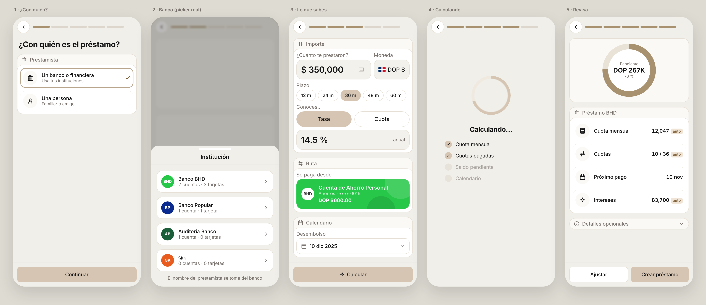
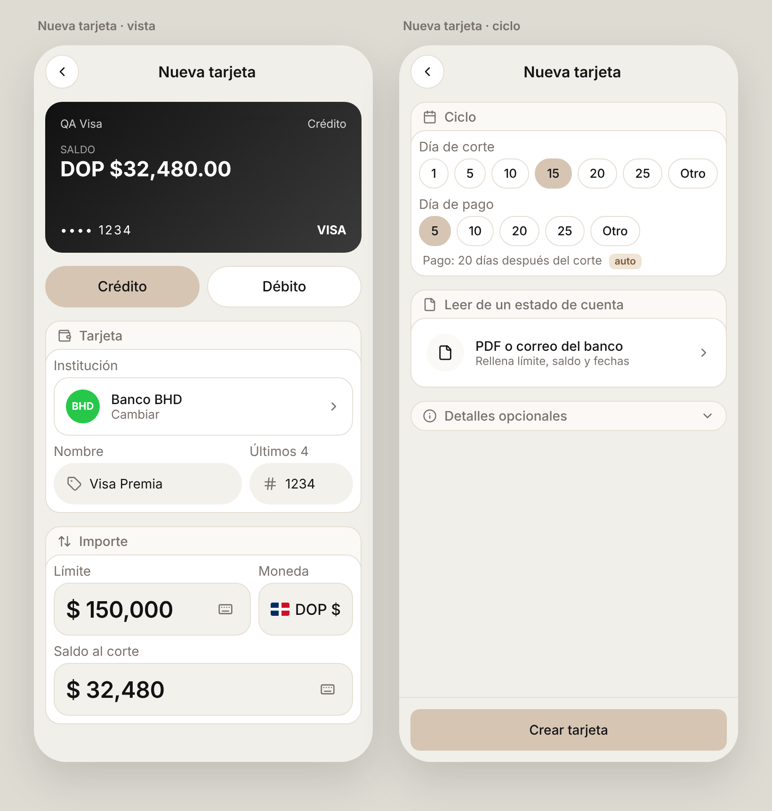
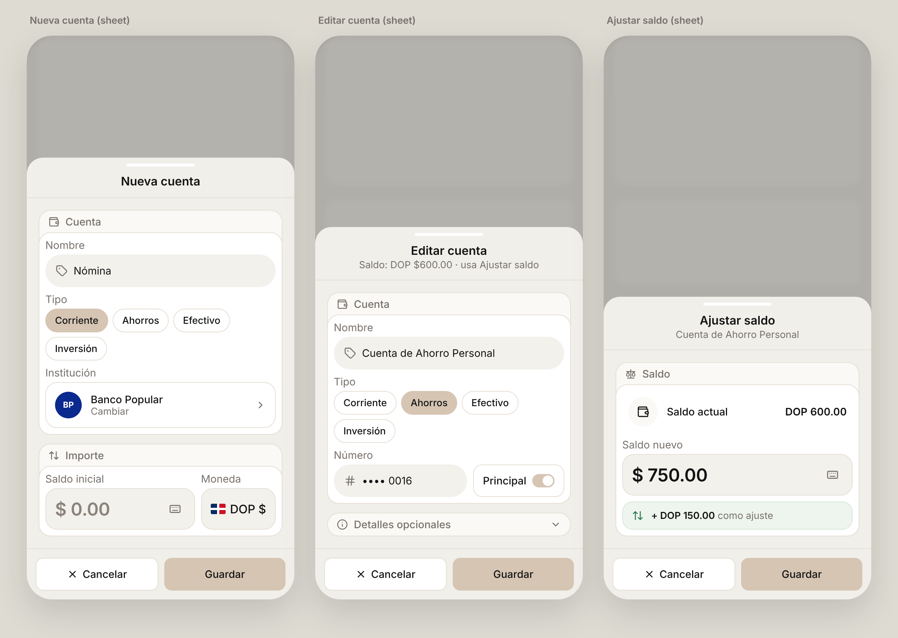
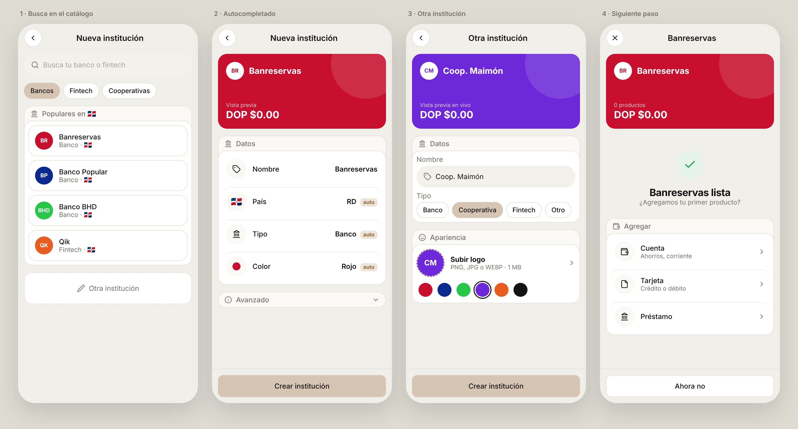
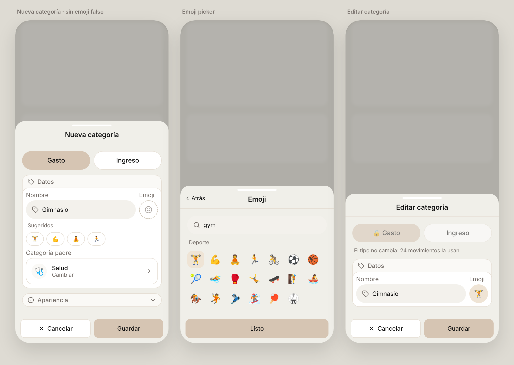
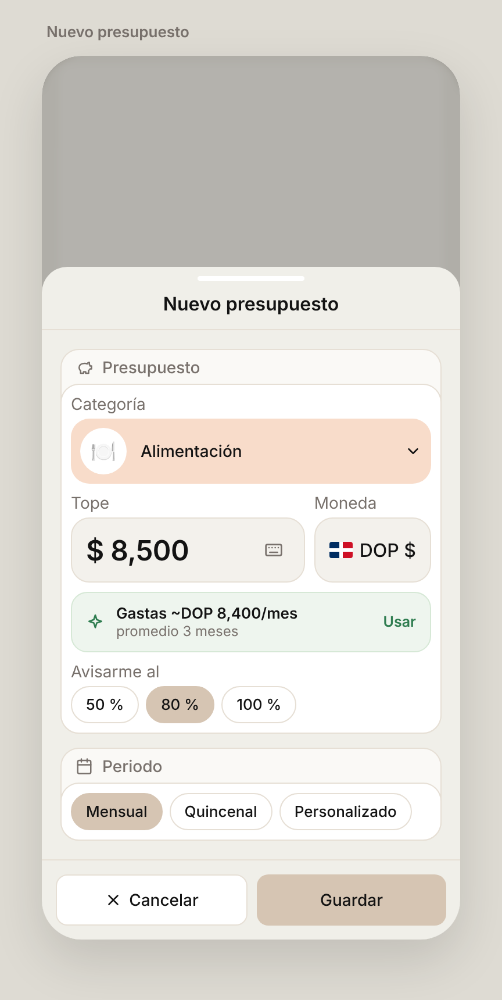
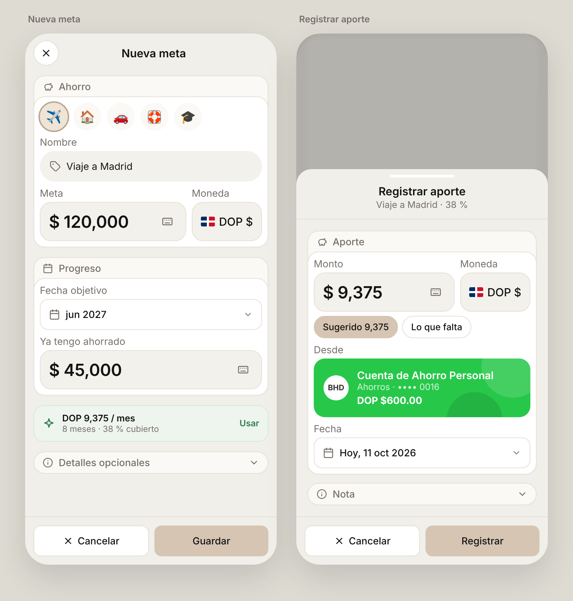
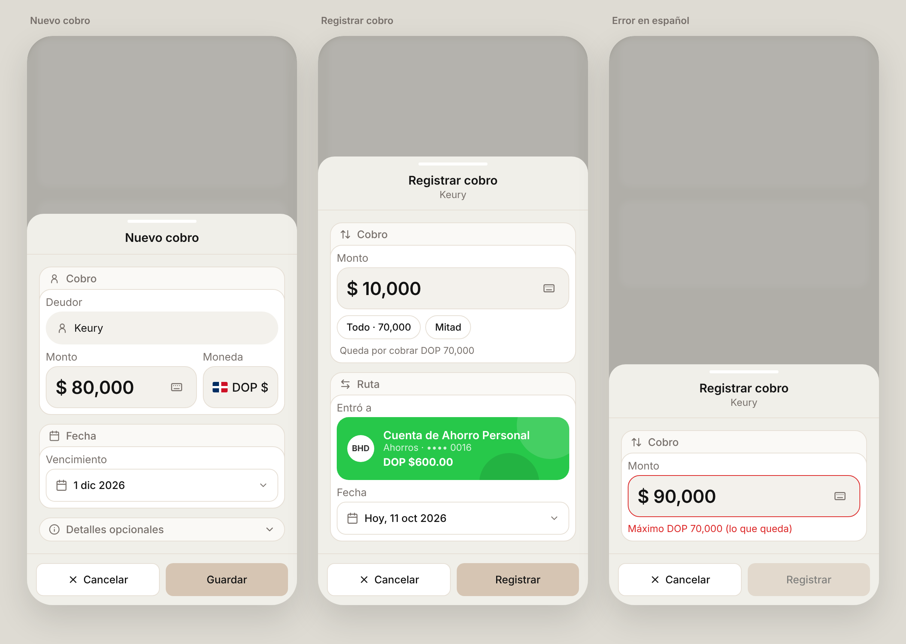
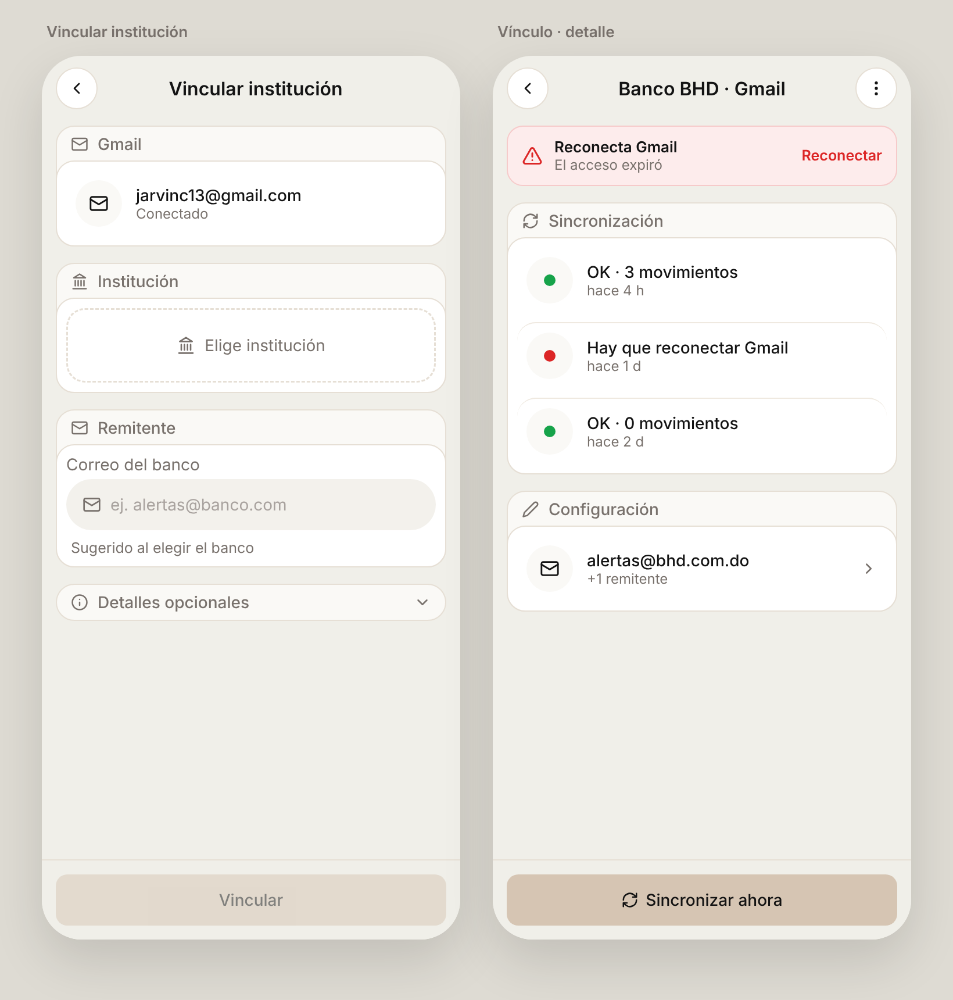
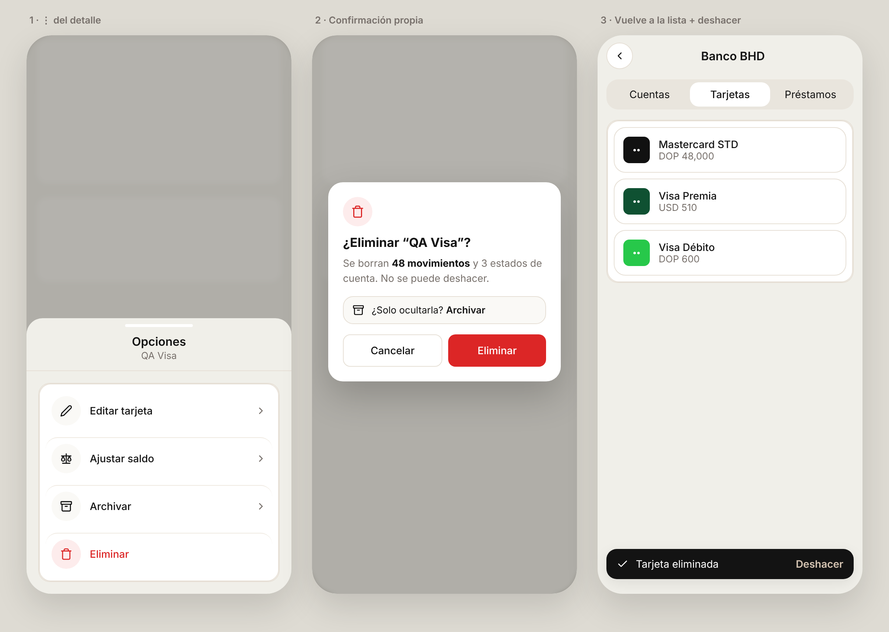

# Auditoría de formularios: Personal OS Web

**App:** personal-os-web-one.vercel.app · **Fecha:** 11 oct 2026 · **Método:** recorrido como usuario nuevo en ancho móvil (~548 px), probando crear y editar en cada entidad, con envíos vacíos e inválidos. Evidencia en `raw/NNN.png` (se cita como #NNN).
**Referencias de buena implementación:** Nuevo gasto/ingreso y Nueva transferencia.

---

## 1. Resumen ejecutivo

| Formulario                                   | Crear / Editar | Contenedor actual                                      | Recomendación                                                   | Severidad                                                          |
| -------------------------------------------- | -------------- | ------------------------------------------------------ | --------------------------------------------------------------- | ------------------------------------------------------------------ |
| Movimiento (gasto/ingreso)                   | C + E          | Vista (`/transactions/new`, `/:id/edit`)               | Vista ✔                                                         | **Alta** (Editar desde el menú no hace nada)                       |
| Transferencia                                | C (sin E)      | Vista (`/transfers/new`)                               | Vista ✔                                                         | **Alta** (no se puede editar)                                      |
| Préstamo                                     | C + E          | Sheet                                                  | **Vista con asistente por pasos**                               | **Crítica** (acepta datos imposibles; ⋮ → Editar préstamo no abre) |
| Tarjeta                                      | C + E          | Sheet                                                  | **Vista**                                                       | Media                                                              |
| Cuenta                                       | C + E          | Sheet                                                  | Sheet                                                           | Baja                                                               |
| Ajustar saldo (cuenta/tarjeta)               | Acción         | Sheet                                                  | Sheet                                                           | Baja                                                               |
| Institución                                  | C + E          | Sheet                                                  | **Vista dedicada, rediseño completo**                           | **Alta**                                                           |
| Categoría                                    | C + E          | Sheet                                                  | Sheet                                                           | **Alta** (el emoji por defecto falla)                              |
| Presupuesto                                  | C + E          | Sheet                                                  | Sheet                                                           | **Alta** (el detalle da error `categoryId must be a UUID`)         |
| Meta de ahorro                               | C + E          | Sheet                                                  | Sheet con sugerencia                                            | Media                                                              |
| Aporte a meta                                | Acción         | Sheet                                                  | Sheet                                                           | Baja                                                               |
| Cobro (por cobrar)                           | C + E          | Sheet                                                  | Sheet                                                           | Media                                                              |
| Registrar cobro (pago)                       | Acción         | Sheet                                                  | Sheet                                                           | **Alta** (error en inglés)                                         |
| Vincular institución (correo)                | C + E          | Sheet                                                  | **Vista** en edición                                            | **Alta** (errores crudos en inglés, preselección)                  |
| Ajustes: Cuenta / Tono / Proveedor / Horario | E              | Sheet                                                  | Sheet                                                           | Media (accesibilidad)                                              |
| Comercios / Suscripciones / Recurrentes      | —              | No existen                                             | Crear vistas                                                    | Media (falta funcionalidad)                                        |
| Borrado (todas las entidades)                | Acción         | Botón dentro del sheet de edición + `confirm()` nativo | ⋮ del detalle → diálogo propio → volver a la lista con deshacer | **Alta**                                                           |

**En total se cubren 16 formularios**: 11 con crear y editar, 4 acciones y 4 sheets de Ajustes. Comercios, suscripciones y recurrentes no tienen formulario. Además se auditó el flujo de borrado (sección 3.17).

**Top 5**

1. **Préstamo sin validación** en cliente ni servidor: se guardó saldo 5,000 con monto 1,000, cuota −10 y 5 pagadas de 2 totales (#118, #157). Además pide tres datos sin relación entre sí: Prestamista, Institución y Cuenta de pago.
2. **Esc dentro de un combobox cierra el sheet entero** y se pierde lo escrito. Pasa en todos los sheets.
3. **Errores crudos o en inglés**: `Payment cannot exceed the outstanding amount` (#147), `String must contain at most 2 character(s)` (#108), `categoryId must be a UUID` (#152), `Gmail tokens could not be decrypted…` (#170, #173).
4. **Editar y borrar no son accesibles**: en el detalle de un movimiento, ⋮ → “Editar movimiento” no hace nada (#180), aunque `/edit` funciona por URL (#182). En el detalle de un préstamo, ⋮ → “Editar préstamo” tampoco abre el sheet (se probó 4 veces); solo funciona `?sheet=loan-sheet` por URL, así que el préstamo no se puede ni editar ni borrar desde la app. Las transferencias no tienen forma de editarse. El borrado usa `confirm()` nativo sin nombrar el elemento y, al terminar, deja al usuario en una página de “No encontramos…”.
5. **Valores por defecto engañosos**: la categoría muestra 🛒 como si estuviera elegida y luego falla con “El icono debe ser un emoji” (#165). Vincular preselecciona “Auditoría Banco” (#171), y el placeholder `alertas@bhd.com.do` parece un valor ya cargado.

---

## 2. Patrones de referencia (Movimiento y Transferencia)

Lo que hacen bien y deberían adoptar los demás (#101, #103, #182):

| Patrón                                       | Detalle                                                                                                                     |
| -------------------------------------------- | --------------------------------------------------------------------------------------------------------------------------- |
| **Vista dedicada con header y botón atrás**  | No es un sheet, tiene URL propia y el CTA queda fijo abajo (“Registrar gasto”, “Transferir”).                               |
| **Toggle segmentado de tipo arriba**         | Gasto / Ingreso como dos pills grandes con icono.                                                                           |
| **Monto protagonista**                       | Input grande `$ 0.00` con botón de teclado y **selector de moneda con bandera** (🇩🇴 DOP $) al lado.                         |
| **Selector de cuenta como tarjeta visual**   | Tarjeta de color con iniciales, tipo, moneda y saldo, en vez de un combobox de texto. Transferencia apila Origen → Destino. |
| **Fecha y hora con chip + toggle de estado** | “11 oct 2026, 4:50 p. m.” con un toggle Pagado/Completado en la misma fila.                                                 |
| **Categoría con picker en bottom sheet**     | Lista con emoji y color, con búsqueda.                                                                                      |
| **“Detalles opcionales” colapsado**          | Descripción y notas quedan fuera del camino principal.                                                                      |
| **Valores por defecto útiles**               | Fecha de ahora, cuenta predeterminada, DOP y Pagado.                                                                        |

Lo que hay que corregir en esos dos: la etiqueta **“Destino”** en un gasto debería decir “Desde” o “Cuenta”. La edición no tiene **Eliminar**. Transferencia no tiene **edición**.

**Formularios que hoy no siguen estos patrones:** préstamo, tarjeta, cuenta, meta, cobro y presupuesto usan chips de texto `DOP USD MXN EUR` en vez del selector con bandera, inputs genéricos para el monto y combobox de texto para la cuenta. Institución usa un `<select>` nativo.

---

## 3. Formularios

### 3.1 Movimiento: crear / editar (vista)

**Bugs**

- ⋮ → “Editar movimiento” en el detalle no navega (se probó 3 veces, #180). La ruta `/finance/transactions/<id>/edit` funciona (#182).
- En edición, un gasto muestra la cuenta como **“Destino”**.

**UI / a11y**

- El picker de categoría se abre como un sheet sobre la vista (#101). Hay que verificar que el foco quede atrapado ahí y vuelva al cerrar.
- “Comercio” es texto libre sin autocompletar, y no existe una entidad de comercio (ver 3.16).

**Campos**

- Agregar **Eliminar** en la edición.
- Agregar autocompletado de comercio con la categoría sugerida a partir del último uso.

**Recomendación:** mantener como vista. Corregir el menú y la etiqueta.

### 3.2 Transferencia: crear (vista)

- No tiene entrada de edición: para corregir un error hay que revertir y volver a crearla. Hay que añadir `/finance/transfers/<id>/edit` y la opción en el menú.
- Si alguien abre `/finance/transactions/new?type=TRANSFER`, se carga el formulario de gasto. Conviene redirigir a `/finance/transfers/new`.
- Un detalle bueno: al elegir el origen se excluye esa cuenta del destino. Hay que confirmar que pasa siempre.

### 3.3 Préstamo: crear / editar (sheet) → **asistente en vista dedicada**

**Bugs (crítico)**

- No hay validación cruzada: acepta saldo > monto original, cuota negativa y pagadas > totales (#118, #119, #157). El backend también lo acepta, así que hay que validar en el DTO.
- Al enviar vacío salen 5 errores rojos a la vez más un toast (#115, #116). Es un muro de rojo.

**Contenido**

- El subtítulo “12% se envía como 0.12. La tasa no es un entero de porcentaje.” es texto de desarrollador (#114).
- **Prestamista** (texto libre), **Institución** (combobox, que por defecto es la institución desde donde se abrió) y **Cuenta de pago** son independientes. Escribir “Banco Popular” en Prestamista no hace nada, y la institución sigue siendo BHD (#114).

**Campos**

- Hoy pide monto, saldo, cuota, cuotas totales y pagadas, frecuencia, vencimiento y tasa (en Detalles opcionales). El usuario tiene que calcular todo por su cuenta.
- **Pedir:** tipo (banco o persona) → institución o nombre → monto, plazo y tasa _o_ cuota → fecha del primer pago o del desembolso.
- **Calcular:** cuota (amortización francesa `P·r(1+r)^n/((1+r)^n−1)`), cuotas pagadas a la fecha, saldo pendiente, próximo vencimiento e intereses totales. Si el usuario da la cuota en vez de la tasa, se despeja la tasa.
- Las cuentas de pago se filtran por la institución elegida. Si es una persona, no se pide institución.

**Recomendación:** asistente de 4 a 5 pasos en vista dedicada (`/finance/loans/new`), con estado “calculando” y una revisión final editable. Edición = la misma vista con un resumen editable, no el asistente completo.

**Bug adicional:** en el detalle, ⋮ (“Opciones del préstamo”) solo ofrece “Editar préstamo”, y al tocarlo el sheet se cierra sin abrir la edición (4 intentos con 4 s de espera, sin errores en consola). Solo funciona `/finance/loans/<id>?sheet=loan-sheet`. Como el botón Borrar vive dentro de ese sheet, **un préstamo no se puede borrar desde la app**.

### 3.4 Tarjeta: crear / editar (sheet) → **vista**

- Campos (#122): Institución, Nombre, Tipo (Crédito/Débito), Red, Últimos 4, Cierre (día), Vencimiento (día), Color, Saldos iniciales (Moneda, Saldo, Límite).
- La validación funciona: “Deben ser 4 dígitos” y “El día debe estar entre 1 y 31” (#123, #124). Pero el campo Saldo acepta escribir `abc` y el límite −500 antes de enviar (#123). Hay que usar un input numérico como el de movimientos.
- “Saldos iniciales” queda al fondo, después de Color. El dato más importante está al final.
- En débito no tienen sentido el cierre, el vencimiento ni el límite. Hay que ocultarlos según el tipo.
- La edición agrega Archivar, Borrar y “Actualizar saldo” (#129). Bien.
- **Propuesta:** vista con vista previa de la tarjeta en vivo, toggle Crédito/Débito, montos con el patrón de movimientos, la red detectada por los dígitos, y la opción de **leer desde un estado de cuenta o correo** (ya existe la sincronización por correo).

### 3.5 Cuenta: crear / editar (sheet)

- Campos: Nombre, Tipo (Corriente/Ahorros/Efectivo/Inversión), Institución (opcional), Número de cuenta, Predeterminada, Moneda, Color (#109, #160).
- En edición conserva el texto de crear, “El saldo empieza en 0…” (#160). Hay que cambiarlo por un texto de edición.
- Si el tipo es Efectivo, sobran Institución y Número de cuenta.
- El combobox de institución usa un menú oscuro (#111) que no coincide con el estilo claro del resto.
- **Sheet ✔.** Agregar “Saldo inicial” opcional al crear, para no tener que hacer después un Ajustar saldo.

### 3.6 Ajustar saldo (sheet)

- Muestra el saldo actual y pide el nuevo (#162). Está bien. El sheet tarda ~2 s en abrir desde el menú y no hay feedback mientras tanto.
- Mostrar la diferencia calculada en vivo (“+DOP 150 como ajuste”).

### 3.7 Institución: crear / editar (sheet) → **vista dedicada, rediseño completo**

**Hoy (#106, #108, #156)**

- Son 9 campos en un sheet: buscador de marca, Nombre, País ISO-2, Dominio, Nombre corto, Tipo (`<select>` **nativo**, el único de la app), Orden, Logo (input de archivo con **“Choose File / No file chosen” en inglés**) y Color.
- Error crudo en inglés: `String must contain at most 2 character(s)` (#108).
- “País (ISO-2)”, “Dominio”, “Nombre corto” y “Orden” son jerga o datos internos. Un usuario nuevo no sabe qué poner.
- No hay vista previa: el resultado (la tarjeta de color de la institución en Productos) solo se ve después de guardar.
- Después de crearla, el usuario queda en una institución vacía sin una guía del siguiente paso.

**Propuesta: vista** `/finance/institutions/new` **en 4 pasos**

1. **Catálogo:** buscador más chips (Bancos / Fintech / Cooperativas) y una lista de “Populares en 🇩🇴” con logo, como filas del `DestinationPickerSheet`. Al final, “Otra institución”.
2. **Autocompletado:** al elegir una del catálogo se rellenan nombre, país, tipo, color y logo (marcados como _auto_). Arriba se muestra una **tarjeta de vista previa** igual a la de Productos. Dominio, nombre corto y orden van en “Avanzado”, colapsado.
3. **Otra institución:** Nombre, **Tipo con chips** (Banco / Cooperativa / Fintech / Otro), **logo con vista previa** (círculo con iniciales mientras no se suba nada; texto en español y límites visibles) y paleta de color. La tarjeta de vista previa se actualiza en vivo. País por defecto el de la moneda base.
4. **Siguiente paso:** “Banreservas lista. ¿Agregamos tu primer producto?” con Cuenta, Tarjeta o Préstamo, que abren el formulario correspondiente con la institución ya elegida. Botón “Ahora no”.

- **Editar:** la misma vista sin el paso 1, con la vista previa arriba, y “Archivar” y “Eliminar” en el ⋮ del detalle (ver sección 3.17).
- Mensajes de validación en español (“Usa 2 letras, p. ej. DO”) si se mantiene el país manual en Avanzado.

### 3.8 Categoría: crear / editar (sheet)

- **Bug:** muestra 🛒 por defecto como si estuviera elegido, y al enviar dice “El icono debe ser un emoji” (#165, #166). El error se parte en una columna angosta y vertical.
- En edición se puede cambiar Gasto↔Ingreso (#169), lo que puede romper el historial. Hay que bloquearlo o pedir confirmación.
- **Sheet ✔.** Si hay un emoji por defecto, debe enviarse de verdad. Mejor aún: dejar el espacio vacío (no un 🛒 falso) y sugerir emojis a partir del nombre. En edición, bloquear el tipo con un candado y explicar por qué.

### 3.9 Presupuesto: crear / editar (sheet)

- Campos: Categoría, Tope, Umbral de alerta (%), Periodo (Mensual/Quincenal/Personalizado + fechas) (#149, #151).
- Acepta un tope de 5 sin advertencia (#151).
- **Bug en el detalle:** `No se pudieron cargar los datos — categoryId must be a UUID` (#152).
- El umbral como número suelto se entiende peor que un slider con chips (50/80/100 %).
- **Propuesta:** sugerir el tope a partir del promedio de gasto de los últimos 3 meses en esa categoría (“Gastas ~DOP 8,400/mes”).

### 3.10 Meta de ahorro: crear / editar (sheet)

- Campos: Nombre, Moneda, Meta, Ahorrado, Fecha objetivo, Detalles opcionales (#132).
- El subtítulo dice que “el API la marca” como completada (#132). Es jerga técnica.
- El picker de fecha es una rueda con años desde 2024 (#133). Una meta no debería aceptar fechas pasadas.
- La edición tiene Eliminar (#139). Bien.
- **Propuesta:** mostrar el aporte mensual sugerido = (meta − ahorrado) / meses, más un emoji o icono.

### 3.11 Aporte a meta (sheet)

- Monto, Fecha (“Sin fecha” por defecto) y Nota (#136). La fecha debería ser **hoy** por defecto.
- Falta elegir la cuenta de origen. El texto dice que “no mueve dinero entre cuentas”, pero el usuario puede esperar que sí lo haga.

### 3.12 Cobro (por cobrar): crear / editar (sheet)

- El subtítulo dice “Pagado sin cobrado deja que **el API** complete el monto.” (#141, #154). Es jerga.
- El campo “Estado” (Pendiente/Parcial/Pagado/Cancelado) sobra al crear, porque siempre es Pendiente. En edición, Parcial y Pagado deberían derivarse de los cobros registrados.
- La validación funciona: “Deudor obligatorio” y “Monto obligatorio” (#142, #155).

### 3.13 Registrar cobro (sheet)

- Muestra `Payment cannot exceed the outstanding amount` en inglés (#147). El sheet ya dice “Queda por cobrar DOP 1,000”, así que hay que validar en el cliente y en español.
- La fecha por defecto es “Sin fecha”. Debería ser hoy. Agregar atajos “Todo” y “Mitad” y la tarjeta de cuenta de los formularios de referencia.

### 3.14 Vincular institución (correo): crear / editar (sheet → vista en edición)

- Preselecciona “Auditoría Banco” sin que el usuario la elija (#171).
- El placeholder `alertas@bhd.com.do` parece un valor ya cargado.
- El error dice “Correo de notificaciones inválido”, pero la etiqueta es “Correo del banco” (#172).
- El subtítulo usa “correo From” (jerga).
- La edición mezcla configuración con un log de sincronización que tiene errores crudos en inglés (#173). Ese log debería ir en una vista de detalle propia, con un aviso claro de “Reconecta Gmail”.

### 3.15 Ajustes

- **Cuenta:** la grilla de ~24 avatares tiene botones sin nombre accesible (todos con alt “Opción de avatar”) y no anuncia cuál está seleccionado (#174). Guardar está desactivado hasta que hay un cambio, pero al vaciar el nombre se activa y da error (#175). Mejor validar en vivo.
- **Proveedor:** muestra ids de modelo crudos (#177). Hay que usar nombres amigables.
- **Horario silencioso:** las ruedas de hora y minuto no tienen etiqueta, y los minutos van de 00 a 59 uno por uno (#178). Conviene usar pasos de 5 o 15 minutos y `aria-label`.
- Los toggles se guardan al instante y los sheets usan Guardar. Esa inconsistencia es aceptable, pero hay que confirmarla con un toast.

### 3.16 Comercios, suscripciones y recurrentes

- `/finance/merchants`, `/subscriptions` y `/recurring` dan 404. “Comercio” es texto libre.
- Recomendación (coherente con el modelo `fin_merchants` ya discutido): una vista de comercios (logo, categoría por defecto) y una de suscripciones detectadas a partir de los recurrentes, con alta en un toque.

---

### 3.17 Borrado y acciones destructivas

Se borraron los datos de prueba de QA y se registró el flujo en cada entidad (capturas en `borrado/`). Los diálogos de confirmación son `confirm()` nativos del navegador, así que no se pueden capturar; el texto quedó anotado.

| Entidad        | Dónde está el botón                                                            | Toques          | Etiqueta            | Confirmación (nativa)                                                                     | Después de borrar                                                                 |
| -------------- | ------------------------------------------------------------------------------ | --------------- | ------------------- | ----------------------------------------------------------------------------------------- | --------------------------------------------------------------------------------- |
| Tarjeta        | Detalle → ⋮ → Editar tarjeta → **scroll** al fondo del sheet                   | ~6 + scroll     | Borrar (+ Archivar) | “¿Borrar esta tarjeta? Se eliminan sus movimientos. No se puede deshacer.”                | Se queda en “No encontramos esta tarjeta / Puede que se haya archivado o borrado” |
| Meta de ahorro | Detalle → ⋮ (abre la edición directo) → abajo a la izquierda                   | 4               | Eliminar            | “¿Eliminar esta meta de ahorro?”, sin decir que tenía 2 aportes                           | “No encontramos esta meta / … o que ya esté completada”                           |
| Cobro          | Detalle → ⋮ (abre la edición directo) → fila inferior                          | 4               | Borrar (+ Archivar) | “¿Borrar este cobro? No se puede deshacer.”                                               | “No encontramos este cobro”                                                       |
| Categoría      | Lista → tocar la fila → botón rojo a lo ancho                                  | 3               | Eliminar categoría  | “¿Eliminar esta categoría? No se puede deshacer.”, sin decir qué pasa con sus movimientos | **Cierra el sheet y se queda en la lista** (el mejor caso)                        |
| Préstamo       | Detalle → ⋮ → Editar préstamo (**no abre**) → solo por URL `?sheet=loan-sheet` | 4 si funcionara | Borrar (+ Archivar) | “¿Borrar este préstamo? No se puede deshacer.”, sin mencionar las cuotas                  | “No encontramos este préstamo”                                                    |

**Hallazgos**

- **Borrar y Eliminar se mezclan**: tarjeta, cobro y préstamo dicen “Borrar”; meta y categoría, “Eliminar”. Los textos de confirmación también mezclan las dos palabras.
- **Siempre está escondido dentro del sheet de edición**, nunca en el detalle. El ⋮ del detalle a veces abre un menú (tarjeta, préstamo) y a veces la edición directa (meta, cobro).
- **Confirmación nativa**: no nombra el elemento, no tiene estilo destructivo y las consecuencias solo se explican en la tarjeta (“Se eliminan sus movimientos”). La meta con aportes y el préstamo con cuotas no avisan nada.
- **Después de borrar**, en tarjeta, meta, cobro y préstamo el usuario queda en una página de “No encontramos…” con textos engañosos (“archivado”, “completada”). Solo categoría vuelve limpio a la lista. Los toasts sí aparecen.
- **Archivar** solo existe en tarjetas, cobros y préstamos. Metas y categorías no lo tienen.
- **Iconos de basura por aporte** en el detalle de la meta (“Borrar aporte”): se pueden confundir con borrar la meta.

**Recomendación**

- Una sola palabra, **“Eliminar”**, siempre en el **⋮ del detalle**, como último ítem en rojo y separado de Editar y Archivar.
- **Diálogo propio** (ya existe `src/shared/components/ui/alert-dialog.tsx`) con el nombre del elemento en el título, las consecuencias concretas (“Se borran 48 movimientos”), la alternativa Archivar cuando aplique y el botón en rojo.
- Al confirmar, **volver a la lista** con un toast “Tarjeta eliminada · **Deshacer**” durante unos segundos (borrado suave en el backend) donde se pueda.
- Archivar también en metas (o “Completar”) y categorías.
- En el detalle de la meta, quitar los iconos de basura sueltos de los aportes: usar deslizar o un menú por fila.

## 4. Problemas transversales

| #   | Problema                                                                   | Acción                                                                                                                      |
| --- | -------------------------------------------------------------------------- | --------------------------------------------------------------------------------------------------------------------------- |
| T1  | **Esc en un combobox abierto cierra todo el sheet** y se pierden los datos | `stopPropagation` en Esc cuando hay un popover abierto. Si el formulario tiene cambios, pedir confirmación antes de cerrar. |
| T2  | Los sheets que se abren desde el menú ⋮ tardan 1.5–2.5 s sin feedback      | Abrir el sheet al instante con un skeleton, o hacer prefetch al abrir el menú.                                              |
| T3  | Errores de API o Zod crudos y en inglés                                    | Capa de mapeo de errores a español. Nunca mostrar `message` del servidor tal cual.                                          |
| T4  | Doble feedback de error (inline + toast con el mismo texto)                | Inline por campo, y toast solo con un resumen (“Revisa 3 campos”). Mover el foco al primer error.                           |
| T5  | Moneda en chips de texto, montos en inputs genéricos                       | Adoptar el input de monto y el selector con bandera de Movimiento.                                                          |
| T6  | Selector de cuenta como combobox de texto                                  | Adoptar la tarjeta visual de cuenta de Movimiento y Transferencia.                                                          |
| T7  | Fechas por defecto “Sin fecha” en acciones de pago                         | Por defecto, hoy.                                                                                                           |
| T8  | Jerga técnica (“API”, “From”, “ISO-2”, “0.12”)                             | Revisar los textos.                                                                                                         |
| T9  | Validación solo en el cliente o ausente (préstamo, tarjeta)                | Validación cruzada en los DTO del backend (class-validator) y en el cliente.                                                |
| T10 | Edición idéntica a crear, con textos de crear                              | Título, subtítulo y CTA propios de edición, y la acción destructiva separada.                                               |
| T11 | Sin estado “cambios sin guardar”                                           | Confirmar al cerrar o desactivar Guardar si no hay cambios, de forma uniforme.                                              |
| T12 | Pickers sin etiqueta accesible (avatares, ruedas, emoji)                   | `aria-label`, `aria-pressed` o `aria-checked`, navegación con flechas.                                                      |

**Ideas extra**

- **Prefill con el agente IA:** “me prestó Juan 20 mil a pagar en 10 meses” → el agente abre el asistente con los campos rellenos y el usuario solo confirma.
- **Duplicar** movimiento o transferencia.
- **Borradores**: guardar en el estado de la URL o en localStorage los formularios largos (préstamo, tarjeta).

### Criterio sheet vs vista

- **Sheet:** 6 campos o menos, una sola entidad, sin ramas (cuenta, categoría, presupuesto, meta, cobro, aportes y ajustes).
- **Vista:** formularios con ramas o cálculos, más de 8 campos, o con contenido de solo lectura mezclado (movimiento, transferencia, préstamo, tarjeta, institución y edición de vínculo de correo).

---

## 5. Plan priorizado

**P0, ya**

1. Validación de préstamo en el cliente y en el backend (saldo ≤ monto, cuota > 0, pagadas ≤ totales).
2. Esc en combobox sin cerrar el sheet + confirmación con cambios sin guardar.
3. Arreglar ⋮ → Editar movimiento.
4. Error `categoryId must be a UUID` en el detalle de presupuesto.
5. Emoji por defecto de categoría que se envía de verdad.
6. Mapeo de errores a español (cobro, institución, Gmail).
7. Arreglar ⋮ → Editar préstamo (hoy no hay forma de editar ni borrar un préstamo desde la app).
8. Después de eliminar, volver a la lista en vez de dejar la página “No encontramos…”.

**P1, próximo sprint**

1. Asistente de préstamo en vista dedicada con autocálculo (mockup).
2. Edición de transferencias.
3. Adoptar el input de monto, el selector de moneda con bandera y la tarjeta de cuenta en tarjeta, meta, cobro y presupuesto.
4. Fecha de hoy por defecto en aportes y cobros. Quitar Estado al crear un cobro.
5. Feedback inmediato al abrir sheets desde menús.
6. Vincular institución: sin preselección, etiquetas coherentes, log fuera del formulario.
7. Patrón de borrado único: “Eliminar” en el ⋮ del detalle y diálogo propio con nombre, consecuencias y estilo destructivo.
8. Rediseño de Institución en vista dedicada (catálogo, autocompletado, vista previa, siguiente paso).

**P2**

1. Tarjeta en vista con vista previa y lectura de estado de cuenta.
2. Sugerencias: tope de presupuesto por historial, aporte mensual en metas.
3. Accesibilidad de avatares, ruedas y emoji.
4. Vistas de comercios y suscripciones.
5. Prefill con el agente IA.
6. Deshacer después de eliminar (borrado suave) y Archivar en metas y categorías.

---

## 6. Mockups

Todos reutilizan los componentes reales de la app (ver detalle abajo) en móvil:
`wizard-prestamo-movil.png`, `tarjeta-movil.png`, `cuenta-movil.png`, `institucion-movil.png`, `categoria-movil.png`, `presupuesto-movil.png`, `meta-ahorro-y-aporte-movil.png`, `cobro-movil.png`, `correo-vinculo-movil.png`, `borrado-patron-movil.png`.

Componentes replicados: `FinanceFormScreen` (header con atrás y CTA fijo con borde superior), `SummarySection` (contenedor `bg-muted` con cabecera de icono y cuerpo `bg-card rounded-2xl`, también colapsable), `FinanceMoneyField` (input `h-14 rounded-2xl` con prefijo y botón de teclado/calculadora más botón de moneda con bandera), `DestinationTrigger` (tarjeta de cuenta de color), `DestinationPickerSheet` (filas de institución con logo, “N cuentas · M tarjetas” y chevron), `FinanceDateField` con el `Switch` a un lado, `BottomSheet` (asa, título centrado con borde, pie Cancelar/Guardar), chips tipo `currency-pills` y colores de `app/globals.css` (primario #D6C5B3, fondo #f0efe9, borde #E6DFD5, destructivo #DC2626).
