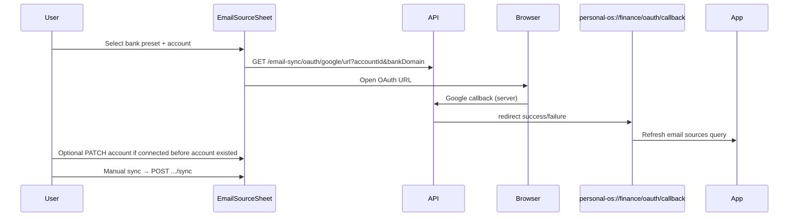

# Finance Module (App)

## Purpose

Mobile client for the Personal OS finance backend: day-to-day money management (accounts, transactions, budgets) and optional **Gmail bank-email import** for Dominican institutions (BHD, Popular, Qik). The module lives under the main app drawer as **Finanzas** and uses TanStack Query for server state.

Backend contract and data model: `personal-os-back/docs/modules/finance.md`.

## Navigation

| Entry      | Path                            | Notes                              |
| ---------- | ------------------------------- | ---------------------------------- |
| Drawer     | `(app)/finance`                 | Label: "Finanzas"                  |
| Tab layout | `app/(app)/finance/_layout.tsx` | Material top tabs + `CustomTabBar` |

### Tabs

| Tab          | Screen file        | Purpose                                                                     |
| ------------ | ------------------ | --------------------------------------------------------------------------- |
| Resumen      | `index.tsx`        | Net worth, cash flow, budget snapshot, spending by category; period filters |
| Movimientos  | `transactions.tsx` | Paginated list, filters, create/edit/confirm transactions                   |
| Presupuestos | `budgets.tsx`      | Categories, budgets, savings goals, loans                                   |
| Cuentas      | `accounts.tsx`     | Institutions, accounts, cards, receivables, Gmail sources                   |

Routes are defined in `shared/constants/app-routes.ts` (`APP_ROUTES.finance.*`).

## Features by tab

### Resumen

- Fetches `GET /finance/analytics/summary` and related endpoints via `useFinanceOverview`.
- Period selection (`overview-period-filters-sheet.tsx`) maps to `dateFrom` / `dateTo`.
- Shows totals: account balance, card debt, income, expenses, net worth, cash flow.
- Budget progress and category spending charts from analytics endpoints.

### Movimientos

- List with search, type, status, account, and card filters (`transaction-filters-sheet.tsx`).
- `TransactionSheet` for create/update; supports account or card target.
- Pending email imports: visible as `PENDING`; confirm action calls `POST .../transactions/:id/confirm`.
- Pagination from API (`PaginatedFinanceTransactions`).

### Presupuestos

- **Categorías**: list + `CategorySheet` (create, edit, delete custom categories).
- **Presupuestos**: `BudgetSheet` — category, period type, limits, alert threshold.
- **Metas de ahorro**: `SavingsGoalSheet`.
- **Préstamos**: `LoanSheet` — lender, installments, balances.

### Cuentas

- **Instituciones y cuentas**: `AccountInstitutionSheet` — CRUD, colors, currencies (`DOP`, `USD`, `EUR`).
- **Tarjetas**: `CardSheet` — institution, type, last four, balances per currency.
- **Por cobrar**: `ReceivableSheet` — debtor, amount, status, due date.
- **Sincronización Gmail**: `EmailSourceSheet` (connect), `EmailSourceEditSheet` (link account, sync, logs).

## Data layer

### API client

`modules/finance/services/finance.api.ts` — typed wrappers for all `/finance/*` routes.

### Hooks (TanStack Query)

| Hook                                                                         | Backend area                               |
| ---------------------------------------------------------------------------- | ------------------------------------------ |
| `useFinanceOverview`                                                         | Analytics summary, spending, budget status |
| `useFinanceTransactions`                                                     | Transactions list + mutations              |
| `useCreateFinanceTransaction`                                                | Create transaction                         |
| `useFinanceInstitutions`                                                     | Institutions CRUD                          |
| `useFinanceAccounts` / `useCreateFinanceAccount` / `useUpdateFinanceAccount` | Accounts                                   |
| `useFinanceCards`                                                            | Cards + balance upsert                     |
| `useFinanceCategories`                                                       | Categories CRUD                            |
| `useFinanceBudgets`                                                          | Budgets CRUD                               |
| `useFinanceSavingsGoals`                                                     | Savings goals CRUD                         |
| `useFinanceLoans`                                                            | Loans list/create/update                   |
| `useFinanceReceivables`                                                      | Receivables                                |
| `useFinanceEmailSources`                                                     | Sources, OAuth URL, sync trigger, PATCH    |

Query keys are colocated in each hook file; invalidation runs after successful mutations.

### Types and validation

| Path                          | Role                                                              |
| ----------------------------- | ----------------------------------------------------------------- |
| `types/finance.types.ts`      | DTO shapes aligned with API responses                             |
| `schemas/*.schema.ts`         | Zod schemas for sheets (account, card, transaction, budget, etc.) |
| `lib/finance-form-mappers.ts` | Form ↔ API payload mapping                                        |
| `lib/format-money.ts`         | Locale-aware money display                                        |
| `lib/finance-period.ts`       | Date range helpers for overview                                   |

## UI components

### Layout (module-specific)

| Component            | Path                                      |
| -------------------- | ----------------------------------------- |
| `FinanceScreen`      | `components/ui/finance-screen.tsx`        |
| `FinanceSection`     | `components/ui/finance-section.tsx`       |
| `FinanceSummaryCard` | `components/ui/finance-summary-card.tsx`  |
| `FinanceListRow`     | `components/ui/finance-list-row.tsx`      |
| `CategoryAvatar`     | `components/ui/category-avatar.tsx`       |
| `CategoryTreeList`   | `components/lists/category-tree-list.tsx` |

### Sheets (`components/sheets/`)

| Sheet                               | Used in                            |
| ----------------------------------- | ---------------------------------- |
| `transaction-sheet.tsx`             | Movimientos                        |
| `transaction-filters-sheet.tsx`     | Movimientos                        |
| `category-sheet.tsx`                | Presupuestos (emoji picker)        |
| `budget-sheet.tsx`                  | Presupuestos                       |
| `savings-goal-sheet.tsx`            | Presupuestos                       |
| `loan-sheet.tsx`                    | Presupuestos                       |
| `account-institution-sheet.tsx`     | Cuentas                            |
| `card-sheet.tsx`                    | Cuentas                            |
| `receivable-sheet.tsx`              | Cuentas                            |
| `email-source-sheet.tsx`            | Cuentas — new Gmail connection     |
| `email-source-edit-sheet.tsx`       | Cuentas — edit source, manual sync |
| `overview-period-filters-sheet.tsx` | Resumen                            |

### Shared sheet primitives

- `shared/components/sheet/sheet-select-field.tsx`
- `shared/hooks/use-sheet-select-insets.ts`
- `shared/lib/sheet-form.ts` (`createSheetSubmit`)
- `shared/lib/dismiss-bottom-sheet.ts`
- `shared/components/charts/spending-bar-chart.tsx` (`victory-native`, drill-down to Movimientos)
- `shared/components/charts/spending-line-chart.tsx` (income vs expenses over time)
- `hooks/use-migrate-category-icons.ts` (one-time Lucide → emoji migration via API)

Barrel: `modules/finance/components/index.ts`.

### Categories

- Icons are **emoji** (`CATEGORY_EMOJI_OPTIONS`); system seed uses emoji in DB.
- `lib/category-display.ts` builds parent/child tree, inherited colors, and grouped select labels.

## Gmail OAuth flow (app)



1. User picks **bank preset** (`BANK_EMAIL_PRESETS`) and **account** in `EmailSourceSheet`.
2. App requests OAuth URL; `accountId` is embedded in signed **state** JWT on the backend.
3. After consent, deep link `personal-os://finance/oauth/callback?success=true|false` returns control to the app.
4. If the source was created without an account, `EmailSourceEditSheet` uses `PATCH /finance/email-sync/sources/:id`.
5. Manual sync shows toast when response is `{ queued: false }` (Redis unavailable).

### Bank email presets

Defined in `modules/finance/constants/finance-options.constants.ts`:

| Label         | `bankDomain`         |
| ------------- | -------------------- |
| BHD           | `bhd.com.do`         |
| Banco Popular | `popularenlinea.com` |
| Qik           | `qik.com.do`         |

Custom domain: `CUSTOM_BANK_PRESET_VALUE` in the same file.

### UX signals

- Badge **Sin cuenta** when `accountId` is null (sync will not run on server).
- Last sync log errors surfaced from `logs` on the source.
- Sync requires server env: Google OAuth, encryption key, Redis for queued jobs.

## AI integration

Chat sessions with `moduleSlug=finance` expose finance tools on the backend. The app does not duplicate tool logic; users open **Chat** from the global shell with finance context when configured.

Tool reference: `personal-os-back/docs/ai-tools/finance-tools.md`.

## Module constants

`modules/finance/constants/finance-options.constants.ts`:

- Account types, card types, transaction types/statuses
- Budget period types, loan frequencies, receivable statuses
- `FINANCE_CURRENCIES`, institution/category color palettes
- `FINANCE_MODULE_ACCENT` from settings metadata

Category icons: `constants/category-icons.constants.ts`.

## File map

```md
modules/finance/
├── components/       # Sheets and tab UI
├── constants/        # Presets, colors, select options
├── hooks/            # TanStack Query
├── lib/              # Formatters, mappers, period helpers
├── schemas/          # Zod
├── services/         # finance.api.ts
└── types/            # finance.types.ts

app/(app)/finance/
├── _layout.tsx       # Tab navigator
├── index.tsx         # Resumen
├── transactions.tsx
├── budgets.tsx
└── accounts.tsx
```

## Operational notes

- **Production Gmail sync**: validate parsers against real user emails; fixtures only cover known templates.
- **Dev without Redis**: CRUD and OAuth work; sync returns `queued: false`.
- **Settings**: Finance can be enabled/disabled per user module config (`settings` module); drawer visibility follows module flags.

## Related documentation

- Backend API and schema: `personal-os-back/docs/modules/finance.md`
- Implementation status checklist: `docs/finance-module-missing.md`
