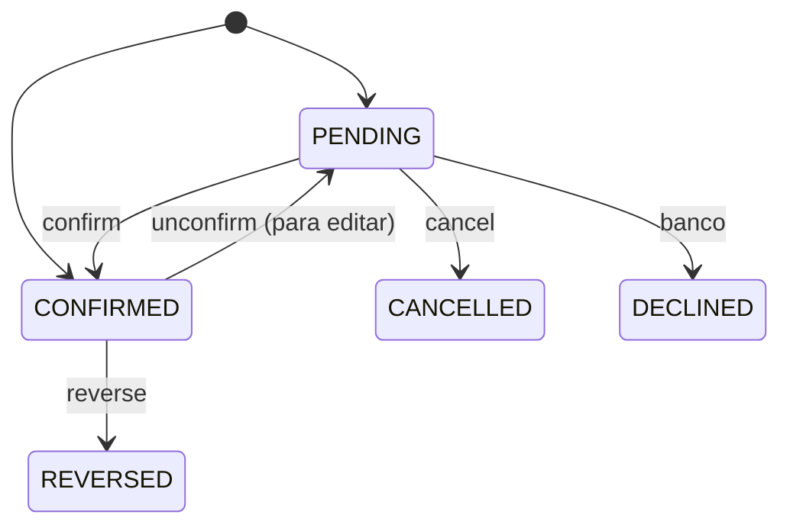

# Spec: alinear el modelo de Finanzas con el dominio real

**Destinatario:** agente pi.
**Repos:** `jarvinc3/personal-os-back` y `jarvinc3/personal-os-web`, rama `develop`.
**Base de esta spec:**

- back `b768249` (v1.5.2): `packages/database/prisma/schema.prisma`, `packages/finance/src/**`;
- web `69e7004` (v1.4.3): `src/modules/finance/**`;
- análisis `../analisis-dominio-y-mejoras.md`.

Los puntos marcados **DECISIÓN (confirmar)** usan por defecto la recomendación del análisis. La alternativa queda escrita al lado; si Jarvin elige la alternativa, se ajusta la fase.

## 1. Glosario

| Término | Significado en el módulo |
| --- | --- |
| Saldo contable (`balance`) | Suma de los movimientos `CONFIRMED` de la cuenta. Es la columna `FinAccount.balance` |
| Disponible estimado | Saldo contable − Σ `PENDING` DEBIT − Σ apartado en metas (fase 05). Se calcula, no se guarda |
| Disponible de tarjeta | `FinCardBalance.balance` = límite − deuda, por moneda |
| Deuda actual | `creditLimit − balance` |
| Balance al corte | Deuda al cierre del ciclo (`FinCardStatement.closingBalance`) |
| Movimiento | Fila de `FinTransaction` |
| Operación | Grupo de movimientos que representan **un hecho**: transferencia, pago de tarjeta o transferencia con comisión. Comparten `transferGroupId` |
| Ajuste | Corrección de saldo (`ADJUSTMENT`). No es ingreso ni gasto |
| Apartado (*earmark*) | Dinero de una cuenta asignado a una meta. No sale de la cuenta |

## 2. Invariantes (todas las fases deben mantenerlas)

1. **I1:** `FinAccount.balance` = Σ de los efectos de sus movimientos `CONFIRMED`. Lo mismo para cada `FinCardBalance` (`balance` = límite − deuda).
2. **I2:** cada movimiento tiene exactamente un destino (`accountId` XOR `cardId`), como hoy.
3. **I3:** solo los movimientos `CONFIRMED` afectan saldo, presupuestos, analítica y patrimonio. `PENDING` solo afecta el "disponible estimado".
4. **I4:** una operación de varias patas se crea, edita, borra y restaura **en una sola `prisma.$transaction`**.
5. **I5:** el gasto (analítica y presupuesto) solo cuenta `DEBIT` `CONFIRMED` de tipo consumo. **No** cuentan `TRANSFER`, `CARD_PAYMENT`, `ADJUSTMENT` ni las patas de una operación.
6. **I6:** el dinero va en `Decimal(15,2)`. Las respuestas lo devuelven como string y las escrituras lo aceptan como number (BR-FIN-016, como hoy).
7. **I7:** todo borrado pasa por `fin_deletion_journal` (`427cc21`), y restaurar no puede aplicar dos veces el mismo efecto (fase 09).

## 3. Máquina de estados del movimiento

Enum actual `FinTransactionStatus`: `PENDING | CONFIRMED | CANCELLED | DECLINED | REVERSED`.

**DECISIÓN (confirmar) D1:** se mantiene `CONFIRMED` en la base y la API, y la UI lo muestra como "Completado". Alternativa: renombrar a `COMPLETED`, que rompe la app móvil y las tools; no se recomienda.

Las reglas de edición de cada estado están en la fase 01.

## 4. Cómo se comporta cada entidad (resumen)

| Entidad | Comportamiento objetivo | Fase |
| --- | --- | --- |
| Movimiento | Se edita completo solo si está `PENDING`; los revertidos son inmutables y no cuentan | 01 |
| Ajuste | Afecta el saldo, no sale en el tablero y sí en el historial de la entidad | 01 |
| Transferencia | Solo de cuenta a cuenta; operación atómica; se edita solo si está `PENDING`; comisión opcional | 02 |
| Pago de tarjeta | Operación `CARD_PAYMENT` (cuenta → tarjeta); no es gasto; se aplica al corte | 03 |
| Corte | Entidad con estado (`OPEN/CLOSED/PAID/PARTIAL/OVERDUE`), mínimo y pagado, por moneda | 03 |
| Préstamo | Tabla francesa; el pago se reparte en mora, seguro, interés y capital; abonos a capital | 04 |
| Meta | Ligada a una cuenta; los aportes son apartados, no gastos | 05 |
| Cobro | Pagos parciales, excedente resuelto por el usuario, castigo | 06 |
| Presupuesto | Multicategoría, con subcategorías y rollover opcional | 07 |
| Correo | Idempotencia fuerte y deduplicación de reversos | 08 |
| Diario de borrados | Restaurar sin doble efecto; retención | 09 |

## 5. Orden de fases

`01 → 02 → 03 → 04 → 05 → 06 → 07 → 08 → 09`

Las fases 08 y 09 son independientes y pueden adelantarse. **La 09 debe ir antes de la 05**, porque la 05 migra los aportes que hoy son `DEBIT`. Orden sugerido: `01, 02, 09, 03, 04, 05, 06, 07, 08`.

## 6. Reglas de PR

1. **Una fase = un PR a `develop`.** El título es `feat(finance): fase NN – <nombre>`, con su entrada en el CHANGELOG y el bump de versión (regla de `dc427ee` y `0b2eed4`).
2. **CI en verde** en los dos repos antes de mergear. Hay que actualizar `test/helpers/prisma.mock.ts` con cada modelo o campo nuevo (ya falló una vez por eso: `2d08e8c`) y correr la suite completa (`c7eb579`).
3. **Migraciones:**
   - **Problema:** ya existen `20261013120000_fin_savings_goal_contribution_account` y `20261015120000_fin_deletion_journal`, con fechas futuras. Prisma aplica las migraciones por orden lexicográfico. Si una migración nueva tiene fecha real (p. ej. `20261012…`) en una base que ya aplicó las del 13 y el 15, `migrate deploy` la aplica igual. Pero en una base nueva se aplicaría **antes** que ellas, en un orden distinto al de producción.
   - **Regla:** **no renombrar** las migraciones ya aplicadas. Hasta el 15 oct, toda migración nueva usa un prefijo **mayor** que `20261015120000` y correlativo: `20261015120100_…`, `20261015120200_…`. A partir del 16 oct se vuelve a usar la fecha real.
   - Antes de mergear, correr `prisma migrate status` en staging.
   - Cada migración de datos va en su **propia** migración SQL, separada de la del esquema, y debe ser idempotente (`WHERE … IS NULL`).
4. **Errores:** el back responde con `{ code, message }`, donde `message` va en español y `code` es estable (p. ej. `TRANSACTION_LOCKED`). La web mapea por `code`; además se agregan esos códigos a `src/modules/finance/shared/lib/finance-error-messages.ts`.
5. **Tools del agente:** cada fase actualiza `packages/ai-agent/src/tools/{tool.registry,tool-arg-schemas,tool-executor.service}.ts` y `docs/modules/finance/contracts/finance-tools.md` si cambia el contrato de la fachada.

## 7. Archivos

| Archivo | Fase |
| --- | --- |
| `01-estados-y-edicion.md` | Estados, edición y ajustes |
| `02-transferencias.md` | Transferencias atómicas |
| `03-tarjetas-y-pagos.md` | Pago de tarjeta y cortes |
| `04-prestamos.md` | Amortización y abonos |
| `05-metas-de-ahorro.md` | Apartados |
| `06-cobros.md` | Excedente y castigo |
| `07-presupuestos.md` | Multicategoría y rollover |
| `08-ingesta-correo-dedupe.md` | Idempotencia |
| `09-restaurar-y-journal.md` | Restaurar sin doble efecto |
